# SmartRail – ER Diagram (updated 19 October 2026 to match the built database)

Reflects ADR-11 (events + current state, services vs journeys), MP-19 (time-bounded operator assignments), D-25 (three languages), and industry practice for lines and stations (many-to-many, distance along the line). The matching PostgreSQL script is `smartrail-schema.sql`. The real schema is created by the EF Core migrations in `smartrail-platform/src/SmartRail.Infrastructure/Persistence/Migrations`; this file and the script are review artefacts.

**Status of each table.** Built means a migration creates it. Everything else is design only and no migration creates it.

| Built (16 tables) | Design only, not built |
|---|---|
| `language`, `line`, `line_translation`, `station`, `station_translation`, `line_station`, `platform`, `train_service`, `service_stop`, `service_cancellation`, `service_change_log`, `journey`, `operator_assignment`, `journey_stop_state`, `train_event`, `journey_exception` | `controller_assignment` (FR-125), `journey_override` (spec 16 F3), `disruption_message` (spec 16 F5, F6), `outbox_message` (D-72), `inbox_message`, `order_reference` (D-71), `train_subscription` (push, FR-75/76), `menu_item` and `menu_item_translation`, and the whole ticketing group (Should, D-60) |

**Changes since the first draft**
- **`train_service`** is no longer one row per train number. It gained `kind` (Weekly or Extra), `version`, `effective_from`, `effective_to` and `superseded_service_id`. The unique key is now (`train_number`, `version`, `effective_from`) (specs 13, 14).
- **New tables `service_cancellation` and `service_change_log`** (specs 13, 14): the cancellation of a train number for a date range, and an audit row for each create, amend and cancel. Nothing is deleted.
- **`journey.status`** gained `Cancelled` (spec 14).
- **`operator_assignment`** gained `ended_by`, `end_reason` (LostDevice, CrewChange, Other) and `end_note` (spec 17).
- **`journey_exception`** is limited to the two types raised today (`ReasonAwaitingVerification`, `EarlyDeparture`), gained `station_id` (where the train was last reported) and `resolved_by_name`, and has a unique index on (`related_event_id`, `type`). `related_journey_id`, `platform_id` and `owner_user_id` are not built. `resolution` now holds `Acknowledged`, `NoActionNeeded`, `Escalated`, `ReasonVerified`, `ReasonChanged` or `Rejected` (spec 16 F2).
- **`train_event`**: the `ReasonVerified` event type is now used (source Controller, payload `reasonCode`, `delayEventId`, `changed`). The append-only trigger is created by the InitialCreate migration.
- **`menu_item` and its translations are not built.** SmartRail reads the menu live from the separate SmallBites system and keeps the last good copy in memory (spec 11 section 14). `station.has_catering_facility` is built (true for Colombo Fort).
- **No other table was added.** In particular there are no tables for overrides, disruptions, closures, controller assignment or tickets yet.

**Update, 12 October 2026 (D-71, D-72), still true:** food ordering is designed but not built; the outbox is designed but not built because SmartRail sends the caterer no train events. The caterer's website address is a setting, not a table.

```mermaid
erDiagram
    LANGUAGE ||--o{ LINE_TRANSLATION : "used in"
    LANGUAGE ||--o{ STATION_TRANSLATION : "used in"
    LINE ||--|{ LINE_TRANSLATION : "named in"
    STATION ||--|{ STATION_TRANSLATION : "named in"

    LINE ||--|{ LINE_STATION : "includes"
    STATION ||--o{ LINE_STATION : "on"
    LINE ||--o{ TRAIN_SERVICE : "has"
    LINE ||--o{ SERVICE_CANCELLATION : "cancelled on"
    TRAIN_SERVICE ||--|{ SERVICE_STOP : "stops at"
    TRAIN_SERVICE |o--o| TRAIN_SERVICE : "superseded by (next version)"
    TRAIN_SERVICE ||--o{ SERVICE_CANCELLATION : "cancelled by"
    TRAIN_SERVICE ||--o{ SERVICE_CHANGE_LOG : "audited by"
    STATION ||--o{ SERVICE_STOP : "served by"
    STATION ||--o{ PLATFORM : "has"
    PLATFORM |o--o{ SERVICE_STOP : "planned platform"
    PLATFORM |o--o{ JOURNEY_STOP_STATE : "current platform"
    TRAIN_SERVICE ||--o{ JOURNEY : "runs as"
    JOURNEY ||--o{ OPERATOR_ASSIGNMENT : "staffed by"
    JOURNEY ||--|{ JOURNEY_STOP_STATE : "tracks"
    SERVICE_STOP ||--o{ JOURNEY_STOP_STATE : "planned as"
    JOURNEY ||--o{ TRAIN_EVENT : "records"
    SERVICE_STOP |o--o{ TRAIN_EVENT : "at"
    JOURNEY ||--o{ JOURNEY_EXCEPTION : "raises"
    STATION |o--o{ JOURNEY_EXCEPTION : "last reported at"
    TRAIN_EVENT |o--o{ JOURNEY_EXCEPTION : "caused by"

    LANGUAGE {
        string code PK "en, si, ta"
        string name
        bool is_default "exactly one; fallback"
    }
    LINE {
        uuid id PK
        string code UK
        string name "default language (English)"
        string operations_phone "line desk (phone fallback)"
    }
    LINE_STATION {
        uuid line_id PK, FK
        uuid station_id PK, FK
        int sequence "UK with line_id"
        decimal distance_km "from the line origin"
    }
    LINE_TRANSLATION {
        uuid line_id PK, FK
        string language_code PK, FK
        string name
    }
    STATION {
        uuid id PK
        string code UK
        string name "default language (English)"
        string contact_phone "optional"
        bool has_catering_facility "true for Colombo Fort"
    }
    PLATFORM {
        uuid id PK
        uuid station_id FK "UK with code"
        string code "e.g. 1, 2A"
    }
    STATION_TRANSLATION {
        uuid station_id PK, FK
        string language_code PK, FK
        string name
    }
    TRAIN_SERVICE {
        uuid id PK
        string train_number "UK with version and effective_from"
        uuid line_id FK
        string service_type "Slow, Express"
        string service_category "Regional, LongDistance"
        string direction "Outbound, Inbound"
        string runs_on "Daily, Weekdays, Weekends, Mon,Wed,Fri"
        int unreserved_capacity "tickets sold without a seat"
        string kind "Weekly, Extra"
        int version "1, 2, ... (amend)"
        date effective_from
        date effective_to "null = in force"
        uuid superseded_service_id FK "the version replaced"
    }
    SERVICE_STOP {
        uuid id PK
        uuid service_id FK
        uuid station_id FK
        int sequence "UK with service_id"
        time scheduled_arrival
        time scheduled_departure
        uuid planned_platform_id FK "optional, a platform of this stop's station"
        bool arrival_report_required "D-08"
        bool collection_eligible "D-15"
    }
    SERVICE_CANCELLATION {
        uuid id PK
        uuid service_id FK
        uuid line_id FK
        string train_number
        date from_date
        date to_date "null = onward"
        string reason "controllers only"
        timestamp created_at
        string created_by
    }
    SERVICE_CHANGE_LOG {
        uuid id PK
        uuid service_id FK
        string action "Created, Amended, Cancelled"
        string actor
        timestamp at
        jsonb details "changes that feed the version summary"
    }
    JOURNEY {
        uuid id PK
        uuid service_id FK
        date operating_date "UK with service_id"
        string status "Unassigned, Scheduled, Running, Completed, Cancelled"
        int version "ADR-09"
        int current_delay_minutes
        timestamp expected_next_event_by "not used yet"
        bool is_overdue "not used yet"
    }
    OPERATOR_ASSIGNMENT {
        uuid id PK
        uuid journey_id FK
        string operator_user_id "Keycloak subject"
        timestamp valid_from "MP-19"
        timestamp valid_to "null = until end"
        string assigned_by
        string ended_by "set when ended early"
        string end_reason "LostDevice, CrewChange, Other"
        string end_note "optional"
    }
    JOURNEY_STOP_STATE {
        uuid journey_id PK, FK
        uuid service_stop_id PK, FK
        timestamp estimated_arrival
        timestamp estimated_departure
        timestamp actual_arrival
        timestamp actual_departure
        uuid platform_id FK "current, optional"
        string confirmation "Pending, Reported, Inferred"
    }
    TRAIN_EVENT {
        uuid id PK
        uuid journey_id FK
        uuid client_event_id "UK with journey_id"
        string event_type "Departed, Arrived, DelayReported, ReasonVerified (built); OverrideSet, OverrideCleared, PlatformChanged, ReportFlagged (allowed, not used)"
        uuid service_stop_id FK "optional"
        timestamp occurred_at
        timestamp received_at
        string source "Operator, Controller, Simulator"
        string created_by
        jsonb payload
        int journey_version_after
    }
    JOURNEY_EXCEPTION {
        uuid id PK
        uuid journey_id FK
        uuid related_event_id FK "UK with type"
        uuid station_id FK "optional, where last reported"
        string type "ReasonAwaitingVerification, EarlyDeparture"
        string severity "Critical, High"
        timestamp created_at
        timestamp resolved_at
        string resolved_by "Keycloak subject"
        string resolved_by_name "display only"
        string resolution "Acknowledged, NoActionNeeded, Escalated, ReasonVerified, ReasonChanged, Rejected"
    }
```

### Design only, not built

These tables are in `smartrail-schema.sql` under "DESIGN ONLY, NOT BUILT". They stay in the design so the model can be completed later; no migration creates them.

```mermaid
erDiagram
    JOURNEY ||--o{ CONTROLLER_ASSIGNMENT : "in charge"
    JOURNEY ||--o{ JOURNEY_OVERRIDE : "overridden by"
    STATION |o--o{ JOURNEY_OVERRIDE : "at"
    JOURNEY |o--o{ DISRUPTION_MESSAGE : "about"
    STATION |o--o{ DISRUPTION_MESSAGE : "about"
    LINE |o--o{ DISRUPTION_MESSAGE : "about"
    JOURNEY |o--o{ OUTBOX_MESSAGE : "notifies"
    JOURNEY ||--o{ ORDER_REFERENCE : "has"
    SERVICE_STOP ||--o{ ORDER_REFERENCE : "collected at"
    JOURNEY ||--o{ TRAIN_SUBSCRIPTION : "followed by"
    STATION ||--o{ MENU_ITEM : "offers"
    MENU_ITEM ||--|{ MENU_ITEM_TRANSLATION : "named in"

    PASSENGER_ACCOUNT ||--o{ SAVED_CARD : "saves"
    PASSENGER_ACCOUNT |o--o{ PURCHASE : "makes"
    SAVED_CARD |o--o{ PURCHASE : "paid with"
    PURCHASE ||--|{ TICKET : "buys"
    JOURNEY |o--o{ TICKET : "long-distance ticket for"
    STATION ||--o{ TICKET : "from and to"
    TRAIN_SERVICE ||--o{ COACH : "has"
    COACH ||--|{ SEAT : "contains"
    TICKET ||--o{ SEAT_RESERVATION : "reserves"
    SEAT ||--o{ SEAT_RESERVATION : "reserved as"
    JOURNEY ||--o{ SEAT_RESERVATION : "on"

    CONTROLLER_ASSIGNMENT {
        uuid id PK
        uuid journey_id FK
        string controller_user_id "Keycloak subject"
        timestamp valid_from "FR-125"
        timestamp valid_to "null = current"
        string assigned_by
        string handover_note "optional"
    }
    JOURNEY_OVERRIDE {
        uuid id PK
        uuid journey_id FK
        string type "Suspended, Cancelled, Terminated"
        uuid at_station_id FK "optional"
        string reason_code
        timestamp set_at
        string set_by
        timestamp cleared_at "null = active"
        string cleared_by
    }
    DISRUPTION_MESSAGE {
        uuid id PK
        uuid journey_id FK "optional"
        uuid station_id FK "optional"
        uuid line_id FK "optional"
        string template_id
        jsonb parameters
        timestamp published_at
        string published_by
        timestamp withdrawn_at
    }
    OUTBOX_MESSAGE {
        uuid message_id PK
        uuid journey_id FK "optional"
        string message_type
        jsonb payload
        int journey_version
        int attempt_count
        timestamp next_attempt_at
        string status "Pending, Delivered, Failed"
        timestamp created_at
    }
    INBOX_MESSAGE {
        uuid message_id PK
        timestamp received_at
    }
    ORDER_REFERENCE {
        string order_id PK "caterer's ID; deferred, D-71"
        uuid journey_id FK
        uuid collection_stop_id FK
        string device_installation_id "anonymous"
        string status
        string rejection_reason
        int order_version "INT-09"
        timestamp updated_at
    }
    TRAIN_SUBSCRIPTION {
        uuid id PK
        uuid journey_id FK
        string push_token "deleted after journey"
        timestamp created_at
    }
    MENU_ITEM {
        string item_id PK "caterer's ID"
        uuid station_id FK
        string name "default language (English)"
        decimal price "display only"
        bool available
        timestamp updated_at
    }
    MENU_ITEM_TRANSLATION {
        string item_id PK, FK
        string language_code PK, FK
        string name
        string description
    }
    FARE_RATE {
        string service_category PK "Regional, LongDistance"
        decimal price_per_km
        decimal minimum_fare
    }
    PASSENGER_ACCOUNT {
        uuid id PK
        string identity_subject UK "identity provider account ID"
        timestamp created_at
    }
    SAVED_CARD {
        uuid id PK
        uuid account_id FK
        string provider_token "provider's reference, not a card"
        string brand
        string last4
        int exp_month
        int exp_year
    }
    COACH {
        uuid id PK
        uuid service_id FK
        int coach_number
    }
    SEAT {
        uuid id PK
        uuid coach_id FK
        string label "for example 12A"
        string channel "App or Counter"
    }
    PURCHASE {
        uuid id PK
        uuid account_id FK "removed on deletion"
        string status "AwaitingPayment, Paid, Declined, Expired"
        decimal total_amount
        string provider_payment_ref UK
        int payment_version
        uuid saved_card_id FK "optional"
    }
    TICKET {
        uuid id PK
        uuid purchase_id FK
        string ticket_type "Regional (Metro), LongDistance"
        uuid journey_id FK "long-distance only"
        date service_date
        uuid origin_station_id FK
        uuid destination_station_id FK
        decimal fare_amount "as quoted"
        string status "Held, Paid, Expired, CancelledByRailway, Cancelled, Refunded"
        string ticket_code UK "shown offline"
        timestamp hold_expires_at
    }
    SEAT_RESERVATION {
        uuid id PK
        uuid ticket_id FK
        uuid journey_id FK
        uuid seat_id FK
        int from_sequence "boarding stop"
        int to_sequence "alighting stop"
        bool active
    }
```

---

## How the model is organised

The model has six groups. The first three exist; the last three are design only.

1. **Languages and translations** (built) – translated names for data
2. **Network reference data and the timetable** (built) – lines, stations, platforms, which stations are on which line, services with versions, their planned stops, cancellations and the change log
3. **Operations** (built) – what actually happens on a given day (journeys, assignments, stop states, events, exceptions)
4. **Passenger communication** (not built) – disruption messages, push subscriptions
5. **Integration** (not built) – outbox, inbox, order references, cached menu
6. **Ticketing and accounts** (not built, Should) – fares, accounts, saved cards, purchases, tickets, seats, reservations

The key idea is the split between **planned** and **actual**: `train_service` and `service_stop` describe what *should* happen; `journey` and `journey_stop_state` describe what *is* happening on a date. All operational data hangs off `journey` (ADR-11).

---

## 1. Languages and translations (built)

`language` holds `en`, `si`, `ta`, with exactly one default (English). `line`, `station` carry a default-language `name`; `line_translation` and `station_translation` hold the other languages, one row per entity per language, keyed by entity ID plus language code. This keeps data readable, gives a built-in fallback to English, and makes adding a language a data change. Interface text and message wording are not stored here: they live in the apps' localisation files (D-52).

**Rule enforced in the application (and tested):** every station shown to passengers has Sinhala and Tamil names. The Sinhala and Tamil text itself is unverified by a native speaker.

---

## 2. Network reference data and the timetable (built)

### LINE and LINE_STATION
A line (the MVP seeds the Main Line) with the operations desk phone number. `line_station` is the ordered list of stations on the line with the cumulative distance from the origin (Colombo Fort 0.0, Maradana 1.9, Ragama 15.5, Gampaha 27.5, Veyangoda 37.5), making station and line many-to-many. There is no stored "number of stops": it is derived.

### STATION and PLATFORM
A station has a code, an English name, an optional contact number and `has_catering_facility` (true only for Colombo Fort). A platform is a place passengers stand, unique by code within a station. It is referenced, not typed, by `service_stop.planned_platform_id` (a composite key with the station ensures it belongs to the same station) and by `journey_stop_state.platform_id` (same-station rule in the application, tested). Platforms are not track modelling (A-24); the same-platform warning is advice (FR-57, A-05).

### TRAIN_SERVICE (changed)
The timetable definition. Since specs 13 and 14 it is **versioned**:
- `kind`: `Weekly` (repeats on `runs_on`) or `Extra` (a one-off for chosen dates).
- `version`, `effective_from`, `effective_to`: an amend inserts version N+1 from a date and ends the old version the day before. Journeys that have not started are re-pointed to the new version; older journeys keep the old times.
- `superseded_service_id`: the version this one replaced.
- A train number can have several rows, so the unique key is (`train_number`, `version`, `effective_from`).
- `runs_on` is `Daily`, `Weekdays`, `Weekends` or a day list such as `Mon,Wed,Fri`. `service_category` (Regional, LongDistance) selects the push threshold (A-07c); `direction` (Outbound, Inbound) says whether it runs away from or toward the line's first station.

### SERVICE_STOP
One stop of a service in order, with scheduled local times (plain `time`, so a stop after midnight is placed on the next day by `ScheduleInstants`), an optional planned platform, and the flags `arrival_report_required` (D-08) and `collection_eligible` (D-15). Unique by sequence and by station within a service. **Application rule (tested):** stops are stations of the service's line, in line order.

### SERVICE_CANCELLATION (new)
Cancels a train number on a line for a date range (`to_date` null means onward), with a reason that is for controllers only. Journeys without events in the range become `Cancelled`; the generator and `ServiceRuns.On` skip those dates. Rows are never deleted.

### SERVICE_CHANGE_LOG (new)
An audit row for each create, amend and cancel of a service: the actor, the time and `details` (for an amend, the changes that feed the version summary).

---

## 3. Operations (built)

### JOURNEY
One run of a service on one date, unique per service and date. `status` is `Unassigned`, `Scheduled`, `Running`, `Completed` or `Cancelled`. `version` rises with every accepted change and drives ADR-09. `expected_next_event_by` and `is_overdue` exist for overdue detection (D-06) but nothing sets them yet. Generated journeys (spec 13) start `Unassigned`.

### OPERATOR_ASSIGNMENT
Which operator is responsible for a journey, for which period (MP-19). `valid_to` null means until the journey ends. A crew change is two consecutive rows. Spec 17 added `ended_by`, `end_reason` and `end_note`: ending early records who, why and when. A report from an operator whose assignment ended for `LostDevice` is refused when it is received at or after the end, whatever time it claims. The operator is a Keycloak user referenced by subject.

### JOURNEY_STOP_STATE
The live state of one stop on one journey: estimated and actual times, current platform (empty means the planned platform applies) and `confirmation` (`Pending`, `Reported`, `Inferred`). Rebuilt from all events in occurrence order after every report.

### TRAIN_EVENT
The append-only history (D-36): operator reports, controller verifications and, later, other controller actions. It records `occurred_at` and `received_at` (P-06). The unique `client_event_id` per journey makes retries harmless (D-35). `payload` is jsonb: a delay report holds the reason and the total or "unknown" (never returned by a public read, D-10); a `ReasonVerified` event holds `reasonCode`, `delayEventId` and `changed`. **The database refuses UPDATE, DELETE and TRUNCATE** with a trigger, for the admin user and for the application role.

### JOURNEY_EXCEPTION
An item in the controllers' queue. Two types are raised today: `ReasonAwaitingVerification` (Critical for TechnicalFault, Obstruction, Weather; High for SignalIssue and Unknown) and `EarlyDeparture` (High). One report raises at most one exception of a type (unique `related_event_id` + `type`), saved in the same transaction as the event. `station_id` is where the train was last reported. Resolving only sets `resolved_at`, `resolved_by` (subject), `resolved_by_name` (display) and `resolution`; rows are never deleted. Verification (spec 16 F2) resolves the exception as `ReasonVerified`, `ReasonChanged` or `Rejected`.

---

## 4 to 6. Design only, not built

- **CONTROLLER_ASSIGNMENT** – a controller in charge of a journey (FR-125, D-74); at most one open row per journey. Deferred.
- **JOURNEY_OVERRIDE** – Suspend, Cancel or Terminate, active until cleared; at most one active per journey (ADR-05). Spec 16 F3, not built.
- **DISRUPTION_MESSAGE** – template ID plus parameters, optionally about a journey, station or line. Spec 16 F5 and F6 are not built; the spec adds `from_station_id` and `to_station_id` for a section (Q6).
- **OUTBOX_MESSAGE, INBOX_MESSAGE** – outbox (ADR-12, D-72) and inbox. Not built: SmartRail sends the caterer nothing and pulls the menu.
- **ORDER_REFERENCE** – the caterer's order ID, journey, collection stop, status and `order_version` (INT-09). Food ordering is designed, not built (D-71).
- **TRAIN_SUBSCRIPTION** – a push token for one journey, deleted after the journey (D-31). Push (FR-75/76) is not built.
- **MENU_ITEM, MENU_ITEM_TRANSLATION** – a cached copy of the caterer's menu. Not built: the menu is read live from SmallBites and the last good copy kept in memory.
- **Ticketing and accounts (Should, D-60, ADR-14)** – `fare_rate`, `passenger_account`, `saved_card`, `coach`, `seat`, `purchase`, `ticket`, `seat_reservation`. Card data never appears in SmartRail (NFR-48); names and email stay in the identity provider (NFR-49); an exclusion constraint on `seat_reservation` would stop overlapping sales of one seat (D-64, NFR-47). None of it has a migration.

---

## Not in the database (by design)

- **Users and roles** – in Keycloak; SmartRail stores the subject ID. Operator names come from `Operators:Directory` configuration behind `IOperatorDirectory` (the Keycloak directory is not built).
- **Interface text and message wording** – in localisation files.
- **Card numbers, security codes and full food orders** – with the payment provider and the caterer.
- **Passenger name and email** – in the identity provider.
- **Line closures** (FR-59) – no table until built (spec 16 F6).
- **Caterer website address** – a setting (`Catering:WebsiteUrl`), not a table.
- **Which lines a controller may see** – not stored; every controller sees every line (A-25).
- **Physical tracks** – not modelled (A-24).
- **Number of stops on a line, and distances between stations** – derived by queries.

## Questions that remain open

1. **Exception owner column** (MP-13, Should): not built; keep it in the design or remove it?
2. **Event payload as JSON:** reason and estimate are not separate columns. Accepted so far.
3. **Station list source:** verify the station and distance list against the railway's page before widening the seed beyond the five stations.
4. **Unused columns:** `journey.expected_next_event_by` and `is_overdue` exist but nothing sets them; keep for overdue detection (D-06) or drop with a migration.
5. **Ticketing questions** (Metro ticket validity, account deletion with a future ticket): unchanged, apply only if ticketing is built.
