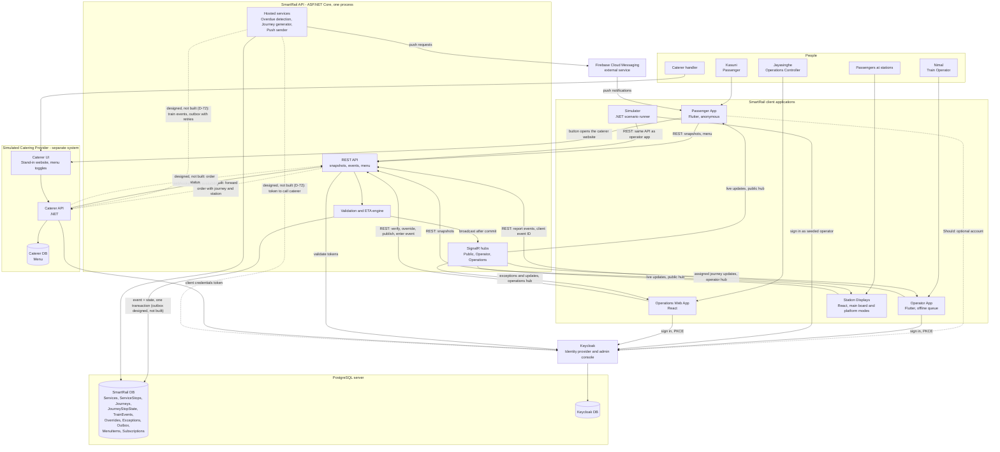

# SmartRail – Container Diagram (MVP)

Reflects ADR-06 to ADR-13. Dashed lines are designed but not built in the MVP. Updated 12 October 2026 (D-71, D-72): food ordering is designed but not built; the passenger app lists the menu and links to the caterer's website.

## Notes

- **Containers vs components:** validation, the ETA engine, the SignalR hubs, and the hosted services run inside the SmartRail API process (MVP simplification). They could be split into a separate worker later.
- **Only direct passenger-to-caterer link:** the button that opens the caterer's website (D-71). SmartRail never handles orders or payment data. Before D-71 this was the hosted payment page (ADR-13); that design is kept, not built.
- **Every webhook message** carries a message ID (idempotent receivers). In the MVP only the caterer's menu messages exist; train events carry the journey version (out-of-order protection) when built (D-72).
- **System-to-system authentication (ADR-12):** both directions use Keycloak client credentials. SmartRail and the caterer are each confidential clients; each obtains a token to call the other, and each validates the other's tokens against Keycloak. One identity provider, one mechanism.
- **Seed data and journeys:** the journey generator uses the controllable clock's date (ADR-06).
