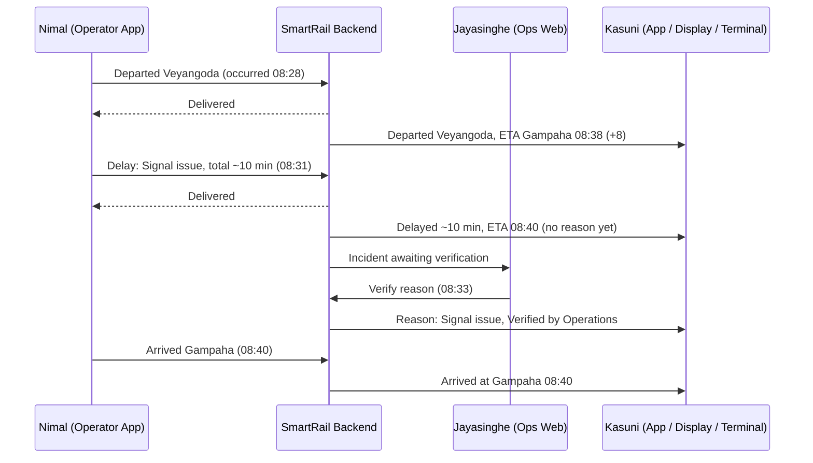
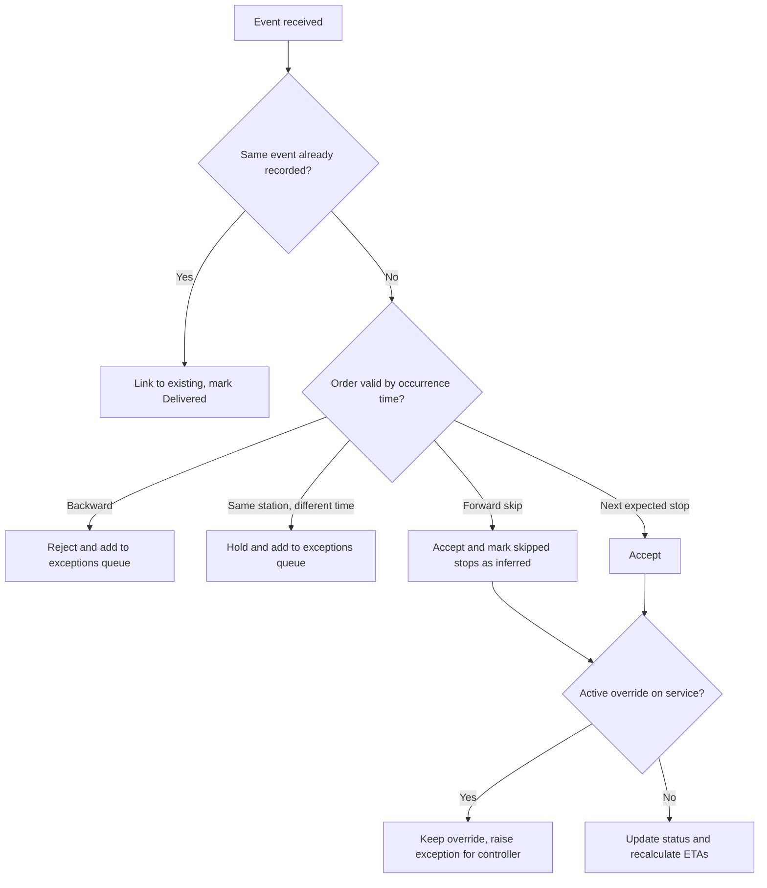
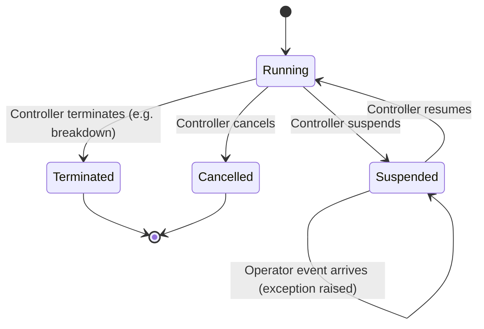
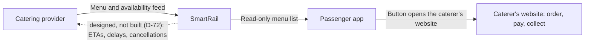
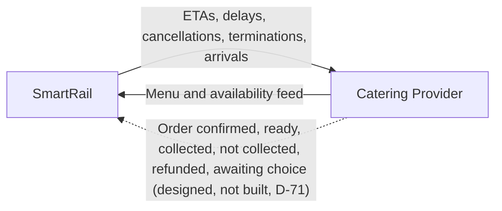
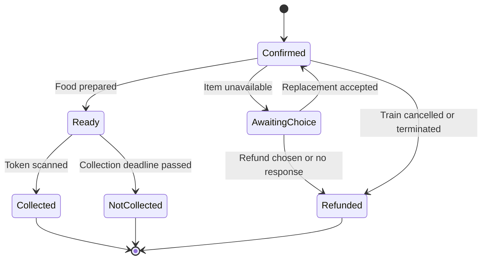
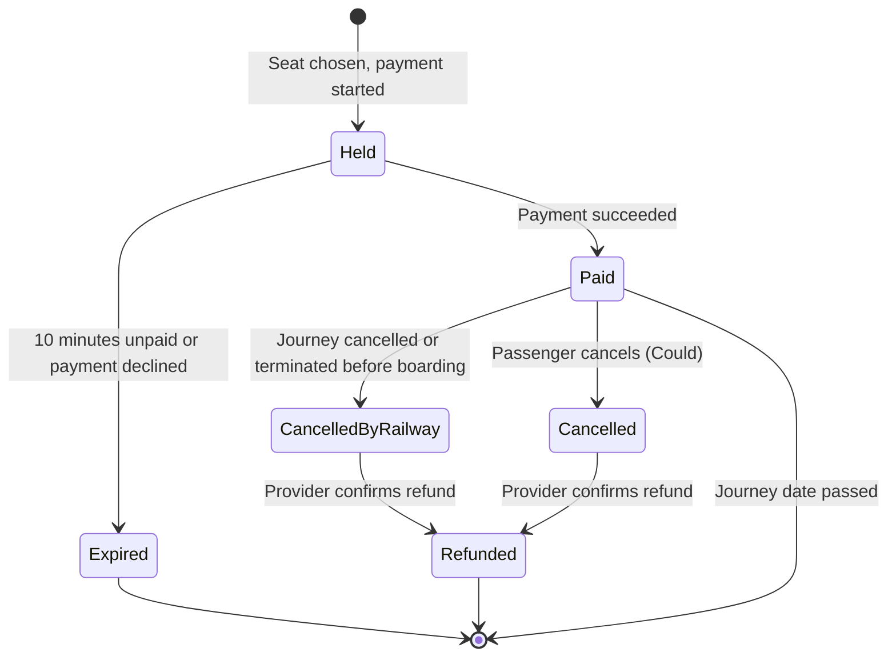

# SmartRail – Requirements Discovery Summary

**Status:** Working document, consolidated from Day 1 discovery (29 Sep 2026); updated with station experience, component scope, epics, MoSCoW, sizing, build order, architecture, UX wireframes, design system, and security review findings (1 Oct 2026); food ordering and train events to the caterer made designed-not-built (12 Oct 2026, D-71, D-72)
**Owner:** Tharindu (all decisions below were made or accepted by the owner; items marked *Assumption* or *Open* are not yet confirmed)

> Anchors for every decision: the **problem statement** (section 1) and the **assessment brief**.

---

## 1. Problem Statement

**Version 2 (current)**

> Sri Lanka Railways currently relies on fragmented systems that provide schedules, reservations, and partial train updates, but lacks a single authoritative source of real-time operational data. Consequently, passengers, external service providers, and railway personnel frequently make decisions based on stale, incomplete, or unavailable information. This results in passenger inconvenience, inefficient railway operations, increased operational costs, and food waste due to the inability to accurately coordinate services with actual train movements.

**Version 1 (history – kept to show the discovery progression)**

> Customers can't exactly get to know the time the train will arrive because the existing applications don't provide real-time updates, which leads to unexpected delays and time wasted and negative feedback for the railway.

What changed from v1 to v2: the cause moved from a missing feature ("no real-time updates") to a root cause (no authoritative data source); the affected parties widened beyond passengers; the solution was removed from the statement.

---

## 2. Context and Assumptions

| ID | Assumption |
|----|-----------|
| A-01 | SmartRail is a fictional organisation, modelled on a Sri Lankan-style national network (real lines, stations, and three languages). |
| A-02 | No hardware will be implemented. Phones/tablets running SmartRail apps are the only devices. |
| A-03 | The **Train Operator** is a separate on-train role (guard/conductor-like) from the **Driver**. The operator reports events; the driver is not a SmartRail actor. |
| A-04 | If the operator's app cannot send an event, the operator can phone the operations desk for their line; the controller enters the event on their behalf. |
| A-05 | Safety-critical data (speed restrictions, signalling) and emergency response are **outside** SmartRail. SmartRail informs; railway radio, signalling, and emergency services control train movement and emergencies. This includes **collision avoidance, movement authority and train protection**: SmartRail never controls trains or detects conflicts between them. |
| A-06 | A **Railway–Caterer Service Agreement** exists and defines refunds, cutoffs, collection deadlines, and compensation. SmartRail does not enforce these policies. |
| A-07 | Thresholds (grace period, notification delay threshold, long-stop dwell of 5+ min) are configurable; initial values are assumptions to be confirmed. |
| A-08 | Planned platforms come from timetable seed data. |
| A-09 | Payments in the prototype are simulated. |
| A-10 | A railway–caterer service agreement defines refunds, cutoffs, and compensation (see A-06). |
| A-11 | An Android emulator with Google Play is an acceptable test device; a real device is used for a final check if one can be borrowed. |
| A-12 | A native Tamil speaker is available to validate translations in week 3. |
| A-13 | Only the catering provider is modelled as an external service provider. |
| A-35 | (12 Oct, D-71) The caterer runs its own public website where passengers order, pay and collect food. SmartRail links to it and does not see the orders. Full list of assumptions: smartrail-assumptions.md. |

> The full requirement discovery register, organised by the categories in brief section 22, is in **smartrail-discovery-register.md**.

---

### Safety boundary

SmartRail is an information and visibility platform. It receives reports of train movements. It does not control trains, grant movement authority, or detect or prevent conflicts between trains (for example, two trains approaching each other on the same track). Those functions belong to the railway's signalling and control systems (A-05). In SmartRail, **Suspend, Cancel and Terminate record a decision** made through the railway's control channels; they do not stop a train, and the operations app says so on screen (FR-63). Physical tracks are not modelled: SmartRail models lines, stations, platforms and services (A-24).

## 3. Existing-Solution Analysis (RDMNS.LK – analogous market research)

RDMNS is a volunteer, passenger-run app in Sri Lanka. It is used here as real-world evidence of the problem, not as SmartRail's existing system.

| Area | Does well | Does poorly | Implication for SmartRail |
|------|-----------|-------------|---------------------------|
| Data source | Community fills the information gap | Data comes from volunteer passengers, not the railway | The railway must be the authoritative source |
| Freshness | Shows "last update" and how long ago; colour legend by age | Many stops show "No information received"; updates can be 30+ min old | Never show silent data; show last verified update |
| Trust | "Thanks for the update" social signal | "Running on schedule" with zero confirmations is ambiguous | Show source and verification ("Verified by Operations") |
| Ecosystem | Links to reservations, e-tickets | Hands off to other organisations' systems via redirects | Evidence of fragmented ownership |
| Language | Sinhala, Tamil, English | — | Three-language requirement (not in the brief) |
| Accessibility | — | Radar status relies heavily on colour | Status must not rely on colour alone |
| Favourites | "My Trains" saved trains | — | Saved journey for commuters |

---

## 4. Actors and MVP Status

| Actor | Type | MVP status | Notes |
|-------|------|-----------|-------|
| Daily commuter (Kasuni) | Primary persona | Implement | Designs are optimised for her when needs conflict |
| Occasional / long-distance passenger | Secondary | Partly served | Via kiosk, displays, food menu with a link to the caterer's website |
| Passengers with language / accessibility needs | Cross-cutting | Implement | Sinhala, Tamil, English; colour-independent status; text scaling; screen readers |
| Passengers without a smartphone | Secondary | Implement | Station displays and kiosk terminal |
| Train Operator (Nimal) | Persona | Implement | Authoritative MVP event source |
| Operations Controller + Customer Information (Jayasinghe) | Persona | Implement | Merged for MVP; designed to split later |
| Station staff | Internal | Design only | Platform changes handled by controller in MVP |
| Scheduler | Internal | Merged | Scheduling is a controller function in the MVP (D-69) |
| System administrator | Internal | Designed | Manages staff accounts and roles through the identity provider's own admin console; no custom admin UI in SmartRail |
| Catering provider | External system | Implement (simulated) | Owns menu, ordering, payment, refunds, fulfilment, on its own website (D-71) |
| Catering handler | Caterer's staff | Not a SmartRail user | Uses the caterer's system |
| Train driver | — | Not an actor | See A-03 |

### Persona summaries

| | Nimal Perera | Kasuni Fernando | S. Jayasinghe |
|---|---|---|---|
| Role | Train Operator (on-train, not driving) | Accounts executive, daily commuter | Senior Operations Controller, Main Line desk |
| Age / location | — | 29, Gampaha → Colombo Fort | 46, Central Operations Centre, Colombo Fort |
| Language | Sinhala (Tamil/English support) | Sinhala | Sinhala and English |
| Accessibility / environment | Large buttons, minimal typing, outdoor contrast | Mild colour-vision deficiency | Dense data, keyboard workflows, multiple monitors |
| Device / connectivity | Railway-issued Android; intermittent | Mid-range Android; occasional loss | Desktop; reliable wired |
| Why chosen | Creates the data | Relies on the data | Oversees, corrects, communicates |

---

## 5. Core Design Principles

| ID | Principle |
|----|-----------|
| P-01 | **One source of truth, multiple presentation channels.** App, displays, and terminal may present differently but never contradict each other or calculate their own ETAs. |
| P-02 | **Passengers never see silent data.** Stale or missing information is always labelled with its age and last verified event. |
| P-03 | **System acknowledgement for normal events; human review for exceptions.** |
| P-04 | **The app prevents mistakes; the backend enforces rules.** (e.g. next-valid-action UI plus server validation) |
| P-05 | **People report; the system derives.** Operators report facts; the system calculates delay, ETA, journey start/end, and inferred passages. |
| P-06 | **Journey order is judged by occurrence time**, not received time. Received time is kept for auditing. |
| P-07 | **Missed reporting is a data-quality issue, not an operational exception.** |
| P-08 | **The operator should spend as little time as possible interacting with the app.** |
| P-09 | **Status and trust are different kinds of information.** Status (On Time, Delayed, Cancelled) and trust metadata (Verified by Operations, last update) are shown separately and never share icons. |
| P-10 | **One icon, one meaning** across the app, displays, and terminal. |
| P-11 | **Words are expensive.** On public displays, use words only where meaning would be ambiguous without them; prefer times, numbers, and icons. |
| P-12 | **Each display answers one question.** Main board: "Where do I need to go?" Platform display: "Should I keep waiting?" |
| P-13 | **Immediate attention, then navigation, then discovery** (screen content order). |
| P-14 | **The most important message is always the largest thing on the screen.** |
| P-15 | **Exceptions are only situations that need intervention.** Every exception type traces to a rule that creates it. |

---

## 6. Live Data Design

### 6.1 Event sources

| Source | MVP |
|--------|-----|
| Operator reports in app (Option A) | Implement |
| Controller entry / override (Option D) | Implement |
| Simulator (Option E) – for demo and testing | Implement |
| Automatic GPS from operator's phone (Option B) | Design only |
| Station staff confirmations (Option C) | Design only |
| Volunteer / crowd reports | Rejected as an authoritative source (problem statement) |

### 6.2 Train movement event (conceptual)

Each event records: train/journey, event type, station, **occurrence time** (device), **received time** (server), **source** (operator / controller entry / simulator / inferred), and reporter.

### 6.3 What the operator reports vs what the system derives

| Operator reports | System derives |
|------------------|----------------|
| Departure at every stop | Journey started (= departure from origin) |
| Arrival at designated stations only (major interchanges, food collection stations, final destination) | Journey completed (= arrival at final station) |
| Delay/incident: reason from list (or "Other" free text) + estimated **total** delay (+10/+15/+20…/Unknown) | Delay minutes, ETAs, passed stops (inferred) |

"Arrival required" is a property of the stop, stored in station/journey data.

### 6.4 ETA engine (MVP)

`ETA at each remaining stop = scheduled time + current delay`

- Current delay = occurrence time of the latest event − its scheduled time, **or** the operator's estimated total delay if more recent.
- Operator estimates are **total delay from the timetable**, not additional minutes.
- Only estimate options greater than the current delay are offered.
- No machine learning or prediction models in the MVP.

### 6.5 Confidence and staleness

- Confidence is based on whether the **next expected event is overdue** (timetable + current delay + grace period), not on raw time since the last update. (Replaced an AI-suggested age-based table.)
- Two kinds of silence are handled separately:
  - **The train is quiet** (no events): "Waiting for update. Last seen: departed Veyangoda 08:28."
  - **The screen is offline** (device lost connection): "You're offline. Showing information from [time]."
- Passenger wording is plain language ("Arrival time may change", "Last verified 2 minutes ago"), never "Confidence: Low".

---

## 7. Core Journey: Train 8058 Delayed Between Veyangoda and Gampaha

**Timetable (Main Line, towards Colombo):** Veyangoda dep 08:20 → Gampaha arr 08:30 (designated arrival station) → Ragama → Colombo Fort.

> Note: reporting times in this timeline were adjusted so that every number is consistent with the "total delay" rule. Verify before using as test data.

### 7.1 Main flow

| Time | Nimal (Operator) | SmartRail backend | Jayasinghe (Controller) | Kasuni (Gampaha, app and platform display) |
|------|------------------|-------------------|--------------------------|---------------------------------------------|
| 08:28 | Taps "Departed Veyangoda" | Records event; delay +8; Gampaha ETA 08:38; acknowledges delivery | No action (normal event) | "Departed Veyangoda 08:28 · Expected 08:38 (+8 min)" |
| 08:31 | Held at signal. Reports delay: *Signal issue*, total ~10 min | Gampaha ETA 08:40; reason held for review; incident added to exceptions queue | Sees incident in queue | "Delayed (~10 min) · ETA 08:40" (no reason yet) |
| 08:33 | — | Publishes verified reason | Verifies reason | "Reason: Signal issue · Verified by Operations" |
| 08:40 | Taps "Arrived Gampaha" | Records arrival | — | "Arrived at Gampaha 08:40" |

**Kasuni's decision:** she sees the delay before reaching the platform, decides to wait, and does not call a taxi. *The value is not that the train is punctual; it is that the information is trustworthy.*

The terminal shows the same data as the display (P-01). It may highlight the delay, but never calculates its own ETA.



### 7.2 Alternative flows

| ID | Situation | Behaviour |
|----|-----------|-----------|
| AF-1 | Operator offline | Event stored on device with occurrence time; "Not sent yet – will send automatically"; auto-sent later; status → Delivered |
| AF-2 | Report rejected (conflict) | Status "Rejected – requires Operations review"; goes to exceptions queue |
| AF-3 | No report arrives (Gampaha expected 08:40, nothing by end of grace period, e.g. 08:45) | Passengers: "Waiting for update. Last seen: departed Veyangoda 08:28"; Controller: "overdue report" exception; no push notification |
| AF-4 | Phone fallback | App shows the correct number for the train's line (e.g. Main Line desk); controller enters event with source "Controller entry, reported by operator by phone"; later operator sync is linked, not duplicated |
| AF-5 | Estimate "Unknown" | Passengers: "Train delayed. Delay duration currently unknown." |
| AF-6 | Reason "Other" (free text) | Free text visible to controller only; never published; controller picks a published reason |

---

## 8. Event Validation Rules

| Rule | Behaviour |
|------|-----------|
| Duplicate (same event received again – taps, retries, sync, phone + app) | Recorded once; operator sees Delivered; no error |
| Same station, different time | Not applied automatically; exceptions queue; operator told it awaits review |
| Forward skip (Ragama reported, Gampaha missing) | Accepted; Gampaha recorded "passed – inferred (operator confirmation missing)" in history; no exception; passengers see normal progress |
| Backward conflict (by **occurrence** time) | Rejected; exceptions queue |
| Late-arriving event in correct occurrence order | Accepted; received time kept for audit |
| Next valid action only | Completed actions disappear; next station action shown; "Report Delay" always available |



---

## 9. Overrides and Disruptions

### 9.1 ADR-05: Overrides remain until explicitly cleared

Operational overrides (Suspended, Cancelled, Terminated, Station Closed, Section Closed) remain active until an Operations Controller clears them. Later operator events do not remove an override; they raise an exception for the controller. Passengers keep seeing the override state (e.g. "Service Suspended") and never see internal uncertainty.

*Train movement events update position and timing. Controller overrides update service state.*



Overrides are designed to target a **train, a station, or a line section**, so section and station closures can be added without redesign.

### 9.2 Disruption types

| Disruption | Handling | Priority |
|------------|----------|----------|
| Delay | Operator delay report + verification | Must |
| Breakdown | "Technical fault" reason, Unknown estimate; "Terminated at [station]" override if it can't continue | Must |
| Cancellation / suspension | Controller override | Must |
| Platform change | Controller changes platform; all channels update; subscribed passengers notified | Should |
| Landslide / flood (line section) | Reports from field or ops centre → exceptions queue (top severity) → controller accepts → section closed; all trains through it affected automatically | Should |
| Station closure | Override targeting a station | **Open** |

Delay reason list includes at least: Signal issue, Technical fault, Obstruction, Weather / natural hazard, Other.

---

## 10. Catering and Food Ordering

**Decision D-71 (12 October 2026): food ordering is designed but not built.** The passenger app shows a read-only list of the caterer's menu items and a button that opens the caterer's own website, where the passenger orders, pays and collects. SmartRail holds no orders, tokens or order references. The menu feed from the caterer stays: it is the working integration with the simulated caterer (brief section 23). **D-72 (same day) also defers train events to the caterer**, so SmartRail sends the caterer nothing in the MVP (brief section 11 says it may need railway information: accepted risk). Sections 10.1 to 10.3 and 10.5 keep the ordering design for a later phase.

### 10.0 What the MVP builds

| Part | MVP |
|------|-----|
| Menu list | Read-only list of the caterer's items for the journey's food stations (FR-90, FR-91): name in the chosen language, price for information, Available or Sold out, and "Menu from [time]" |
| Link | One button, "Order on the caterer's website", opens the caterer's site outside SmartRail (FR-124); the address may carry the station code and train number, nothing else |
| Train events to the caterer | **Not built (D-72).** Designed: ETAs, delays, cancellations, terminations and arrivals, through the outbox with retries, message ID and journey version (FR-95) |
| Simulated caterer | Menu and availability feed, and a stand-in page for its website; no orders, payments or train events (FR-100) |
| Not built | Placing and paying for orders, order status, collection token, refunds shown in the app, rate limit on orders (FR-92 to FR-94, FR-96 to FR-99, FR-101, FR-102) |



### 10.1 Ownership boundary

| Catering provider owns | SmartRail owns |
|------------------------|----------------|
| Menu, prices, availability | Accurate, timely train data |
| Payment (taken at ordering) and refunds | Delivering train events to the caterer reliably (designed, not built, D-72) |
| Food preparation and handover | Showing the menu list and the link to the caterer's website (D-71; order status display is designed, not built) |
| Collection handlers (caterer's employees) | Listing menus for eligible stations (D-71) |

**Why the caterer takes payment (option B):** reduced complexity, SmartRail never handles payment data (smaller security scope), and a clear accountability boundary, consistent with brief section 12. Since D-71 the caterer also takes the order itself, on its own website.

### 10.2 Business rules (designed, not built, D-71)

*In the MVP these are the caterer's own rules on its own website. They are kept here as the specification for a later phase.*

| Situation | Rule |
|-----------|------|
| Ordering window | Until the station-specific preparation cutoff, **fixed to the timetable**, set by the caterer |
| Change / cancel | Until the cutoff |
| Train delayed but reaches station | Order continues; preparation follows live ETA |
| Train cancelled or terminated before collection station | Automatic **full refund** per service agreement; alternatives only with passenger consent |
| Item unavailable after ordering | Caterer offers replacement or refund; no response by deadline → full refund |
| Passenger misses collection | Marked Not Collected; no automatic refund (responsibility passes to passenger once the train arrives and food is ready) |

### 10.3 Collection (designed, not built, D-71)

*Only the eligible-stations rule is used in the MVP: it decides which stations get a menu list (FR-91).*

- **Eligible stations:** the passenger's destination, or approved stations with a scheduled long stop (5+ min) and catering facilities. No collection at normal 1–2 min stops.
- **Fixed collection point** on the platform (e.g. "Food Pickup Counter A").
- **One-time token** (QR + code, e.g. GPH-4827), stored on the passenger's device when the order is confirmed so it works offline.
- The handler only needs the token and items, not the passenger's name or phone (data minimisation).

### 10.4 Integration events



### 10.5 Order status as seen by Kasuni (designed, not built, D-71)



---

## 11. Station Experience

### 11.1 Display types (one web application, different modes)

| | Main station board (entrance) | Platform display |
|---|---|---|
| Question it answers | Where do I need to go? | Should I keep waiting? |
| Content | Upcoming trains, destinations, platforms, status, short service alerts | One train: number, destination, ETA, status, delay, last update, verification |
| Offline behaviour | Keeps showing last known / scheduled information, clearly labelled as not live, with last synchronised time | Keeps showing last known information, labelled "Live updates unavailable", with last verified time |

Displays never freeze while looking current (P-02).

### 11.2 Platform display example (Platform 2, Gampaha)

```
Platform 2
8058   Colombo Fort   [Sinhala] [Tamil] [English]
08:40
[Delayed icon] +10 min   Delayed [three languages]
[Shield icon] 08:31
```

### 11.3 Languages on public displays

- Sinhala, Tamil, and English shown **side by side**, not rotating, so critical information is never hidden by the language cycle.
- Destinations, statuses, and any remaining labels appear in all three languages; times, platform numbers, train numbers, and icons are language-neutral.

### 11.4 Icons and accessibility

- Status is shown with text and icon, never colour alone (Kasuni's colour-vision need applies to displays too).
- Verification uses a dedicated shield-style badge, never a status icon.
- Icons are chosen for their meaning to passengers in a station (e.g. avoid "no entry" style symbols for "offline") and must be usability-tested.
- A consistent icon library is used, not emoji.
- Large, high-contrast text readable across a platform.

### 11.5 Announcements

- **Should:** announcement text generated from the same event stream as the displays.
- **Design only:** audio playback, text-to-speech, PA hardware.

### 11.6 Station terminal (Could)

Purpose: *"I don't have the SmartRail app. How do I find my train?"*

1. Search destination
2. Journey results: next train, platform, ETA, status
3. Train details: stops, last verified update, verified reason

Terminal screens (FR-85): language, destination (common places, or A to Z), next trains, train details, station service alerts, a live-updates-unavailable state, and an inactivity countdown. Portrait touchscreen (proposed 1080 by 1920), controls in the lower half, no typing.

Terminal-specific requirements (single user at a time): language chosen per user; reset after inactivity; reachable touch targets and arm's-length readability. The terminal never calculates its own ETA (P-01).

---

## 12. Component Scope

| Component | Priority | Reason |
|-----------|----------|--------|
| Backend + event processing + ETA engine | Must | Core platform capability |
| Operations web app | Must | Required to manage and verify operations |
| Train operator app | Must | Primary source of live events in the MVP |
| Passenger mobile app | Must | Primary passenger experience |
| Simulator | Must | Enables demos, testing, and live-train scenarios |
| Simulated catering integration | Must | Explicitly required by the brief. Since D-71: a menu feed, an event receiver and a stand-in website; no orders or payments |
| Station displays (main board + platform modes) | Must | Satisfies the required Station Experience deliverable and shows the live information flow |
| Station terminal | Could | Valuable, but largely reuses passenger functionality |

**Fallback if behind schedule:** cut the terminal first. Displays alone satisfy brief section 23.

---

## 13. POV Statements and HMW Questions

Traceability chain: **Problem statement → Persona → POV → HMW → Epic → Story**

| Persona | POV | Key HMWs |
|---------|-----|----------|
| Kasuni | Needs to decide whether to wait, change plans, or continue her journey, because the value of railway information is not that the train is on time, but that the information is trustworthy enough to act on. | Help passengers make confident decisions even when trains are delayed · Make it obvious when information is current, verified, or outdated · Keep information consistent across app, displays, and terminal |
| Nimal | Needs to report operational events with minimal effort, because his primary job is running the service safely, not updating systems. *(Insight is a hypothesis.)* | Capture reliable live information without distracting operators · Let operators report disruptions quickly with minimal typing · Make sure operators know whether reports reached Operations |
| Jayasinghe | Needs to quickly identify, verify, and communicate significant operational issues, because passengers lose trust when information is inconsistent, delayed, or incorrect. | Help controllers focus on genuine issues · Publish verified information quickly without publishing unverified explanations · Maintain one trusted view of the network during disruptions |

Full POV/HMW write-ups are kept separately (drafted with Microsoft Copilot; see AI usage log).

---

## 14. Epics and Thin Slices

| Epic | Scope (thin slice) | Size | Days |
|------|--------------------|------|------|
| E01 Identity & Access | Identity provider with seeded operators/controllers/roles (realm import); sign-in for operator and operations apps; role checks in API; assigned-journey rule; system-to-system auth for caterer | M (risk) | 1 |
| E02 Reference Data & Simulator | Seed data (one line); replay engine using the operator API; scenarios as data (delay, silence, delayed delivery, incident); controllable clock (ADR-06) | L | 3 (≈2 after skeleton) |
| E03 Train Operator Reporting | Journey view with next valid action; departure, designated arrival, delay (reason list, total estimate, Unknown); offline queue; delivery status | L | 2 |
| E04 Live Status & ETA | Event ingestion (with source attribution); validation rules; ETA engine; overdue detection + freshness; verification state and staged publishing | L | 3 |
| E05 Operations Control | Active trains list; single prioritised exceptions list; verify and publish; enter event on operator's behalf; one generic service-state override (Suspend/Cancel/Terminate); disruption message | L | 3.5 |
| E06 Passenger Journey Information | Train search; live status screen; stale/offline states (accessibility and languages via Definition of Done) | M+ | 2 |
| E07 Notifications | "Notify me" device subscription (server-side); rules for delay threshold, cancel, suspend, terminate; Android push (FCM); real-device testing | L | 3 |
| E08 Catering Integration | Menu with available true/false shown as a read-only list; link to the caterer's website; simulated caterer (menu feed, stand-in website). Designed, not built (D-72): train events → caterer (outbox). Designed, not built (D-71): order; order status; collection token; order events → SmartRail; automatic refund on cancel/terminate | M (was L; to re-estimate, D-71) | 4 |
| E09 Station Experience | Main board mode; platform display mode; offline behaviour; trilingual layout | M+ | 2 |
| E11 Ticketing & Accounts (Should, D-60) | Metro and long-distance tickets with fare quote; seat map, 10-minute hold and no double sale; sign-in at purchase; simulated payment provider (hosted page, optional saved card, refunds); purchase history; automatic refund on cancellation | L | 4–6 |
| E10 Quality, Security & Operations | Threat model; security controls and testing evidence; 5 automated E2E tests; audit trail; structured logging | — | Counted in capacity |

**Definition of Done (applies to every story):** strings translatable and available in Sinhala, Tamil, and English; status never conveyed by colour alone; screen-reader labels; scalable text; controller actions audited; relevant tests written.

### Identity decisions
- Passengers: anonymous, device-based use (Must); optional account (Should).
- Staff accounts are seed data; the System Administrator uses the identity provider's console.
- Authentication and roles come from the identity provider; journey-based authorisation is SmartRail's responsibility. Operators may only create events for journeys assigned to them.
- Controllers may manage all journeys (MVP simplification; line-based access designed).
- Identity provider: **Keycloak** (ADR-08), whose admin console serves the System Administrator.

### Seed data scope
- **One line (Main Line).** Operational stations: Veyangoda, Gampaha, Ragama, Maradana, Colombo Fort.
- **5 commuter trains** (both directions) for the main board, plus **1 long-distance train Colombo Fort → Badulla** for catering (collection at the destination, Badulla, or at an approved long stop of 5+ minutes if the real timetable has one). It stays on the Main Line, so no through-running across lines is needed.
- Badulla route (stopping pattern and times from the railway's published timetable, not invented): Colombo Fort → Maradana → Ragama → Gampaha → Veyangoda → … → Polgahawela → Rambukkana → Kadugannawa → Peradeniya Junction → Gampola → Nawalapitiya → Hatton → Nanu Oya → … → Ella → Badulla. Kandy is not on the Main Line (owner decision, AMB-14).

### Simulator decisions
- Plays the **train side only** (what the operator would report); controller decisions are made in the operations app.
- Uses the **same API** as the operator app, signed in as a seeded operator; events recorded with source "simulator".
- Scenarios are **data-driven scripts** run by one replay engine; they double as E2E test fixtures.
- Every simulator capability must trace to a demo scenario, acceptance criterion, or E2E test.

### ADR-06: Controllable time source
- All time-dependent logic (ETA, overdue detection, simulator) uses an abstract clock: real clock in production, simulated clock in demo and tests.
- The **backend is the authority on current time**; API responses include server time. Apps record the offset between server and device time and use *device time + offset*, so freshness keeps ageing offline and offline events are stamped in the correct timeline.
- Occurrence times from devices are validated; current time from the server is trusted.
- The simulated clock must not exist in production builds (threat model item).
- The threat model must state the safety boundary (§2): SmartRail is information only and cannot be used as movement authority.
- Demo mode needs step/pause control as well as speed.

### Notifications decisions
- Push is Must because notifications must reach passengers when the app is closed. Android only for the MVP; iOS designed, deferred.
- No push for overdue reports or minor changes (alert fatigue).
- **Privacy:** device push tokens are passenger-related personal data; subscriptions are kept only for active journeys and deleted afterwards.

### Catering slice decisions
- **Changed on 12 October (D-71): food ordering is designed but not built.** Must outcomes now: the menu list with availability and the link to the caterer's website. **Changed on 12 October (D-72): train events to the caterer are also designed, not built** (outbox, retries, message ID, journey version).
- Simulated caterer: a menu and availability feed with toggles and a stand-in page for the caterer's website. It takes no orders, payments or train events.
- Designed, not built (kept for a later phase): the Collected, Refunded (automatic on cancel/terminate, event-driven) and Not Collected outcomes; item unavailable / Awaiting Choice; the orders list (Mark Ready, Mark Collected); the simulated hosted payment page. Refunds were never a manual button.
- The integration follows ADR-13 as amended by D-71: discovery through SmartRail (the menu list), order placement and payment on the caterer's own website.

### Languages
- All three languages fully implemented. Sinhala validated by the owner; Tamil validated by a native-speaker friend in one batch review (week 3). Fallback: mark Tamil "pending native-speaker validation".
- Font rendering spike in the walking skeleton.

---

## 15. MoSCoW Summary

**Must:** E01–E09 thin slices above, plus E10 required artifacts (threat model, security controls and testing evidence, 5 E2E tests, audit trail).

Added during wireframing (to size before the checkpoint): "Something's wrong with my last report" flag (D-41, size S); queue-aware next action in the operator app.

**Should:** Passenger accounts (needed only to buy a ticket) · Ticketing, E11 (Metro and long-distance tickets, seat reservation, optional saved card, purchase history, automatic refund; section 26) · Save regular journey · Full correction of operator reports (journey-state recalculation, D-40) · Recent events feed (operations) · Location-based origin station · Change platform (and platform-change notifications/display text, with a platform-conflict warning) · Line selector in the operations app · Section closure · Phone fallback screen · "Other" free-text delay reason · Estimate-above-current-delay UI (backend flags instead) · Item unavailable / Awaiting Choice (designed, not built, D-71) · Announcement text generation · iOS push · Notification preferences

**Could:** Station terminal (3 screens) · Historical reporting · Station closure override · Order cancellation for very large delays (designed, not built, D-71)

**Designed, not built (D-71):** food ordering: order placement, payment, order status, collection token, automatic refund shown in the app, item unavailable / Awaiting Choice, order cancellation for very large delays. The MVP shows the menu as a list and links to the caterer's website.

**Won't (this time):**

| Item | Reason |
|------|--------|
| Ticket inspection, gates and paper tickets · season passes, concessions and group fares · ticket resale · changes between trains | Beyond the passenger-information problem. Ticketing itself was Won't (MP-14) and became a Should on 8 Oct (D-60) |
| GPS tracking | Designed only; operator events suffice for MVP |
| Station staff app | Designed only; controller covers platform changes |
| Driver as a SmartRail user | Operator reports instead, for safety |
| Speed restrictions, signalling, emergency coordination | Safety-critical systems outside SmartRail |
| Collision avoidance, movement authority, train protection | Safety-critical; belongs to the railway's signalling and control systems (A-05) |
| Track-level modelling (tracks, single and double track working, crossing loops, track occupancy) | Passenger information needs platforms and direction, not tracks; infrastructure detail belongs to signalling and infrastructure systems (A-24) |
| Audio playback and PA systems | Hardware; text generation only |
| Caterer handler app | Belongs to the caterer's system |
| In-coach food delivery | Fixed collection points instead |
| Food ordering inside SmartRail: placing and paying for orders, order status, collection token, refunds shown in the app | Designed, not built (D-71): the caterer's own website takes food orders. The menu list and the link are built |
| Machine-learning ETAs | Timetable + delay is explainable and testable |
| Real payments | Simulated |
| Crowd-sourced passenger reports | Contradicts the authoritative-source principle |
| Custom admin UI in SmartRail | Identity provider console used instead |
| News feed | Present in RDMNS, but not linked to any problem, persona, HMW, or story |
| Line selector | One line seeded; adds nothing until more lines exist |
| "Trains at my station" on the passenger home screen | Shown on the main board and platform displays; search covers passengers away from the station |
| Additional railway lines | Same behaviour, more data |
| Any hardware | Assumption A-02 |

---

## 16. Capacity and Sizing

| Period | Dates | Use |
|--------|-------|-----|
| Thu 1 Oct | 1 Oct | Architecture and technology decisions (ADR-07 to ADR-13), container diagram |
| Fri 2 Oct | 2 Oct | Four core wireframes (morning, rough), walking skeleton start |
| Mon 5 Oct | 5 Oct | Skeleton finish, push spike (push first if skeleton overruns) |
| Week 2 (rest) | 6 – 9 Oct | Slices 1–4, catering skeleton, checkpoint Fri 9 Oct |
| Week 3 | 12 – 16 Oct | Slices 5–7, testing, security, documentation |
| Buffer | 19 – 20 Oct | Buffer and demo rehearsal |

**Estimated Must effort ≈ 22.5 days vs ≈ 7 build days (≈ 3× gap).** Build days fell from 8 to 7 because architecture work moved to Thu 1 Oct. On 12 October D-71 took order placement, payment, order status, the collection token and refund mirroring out of E08 and moved FR-92 to FR-99 out of the Musts; the size of that saving has not been re-estimated, so the figures in this section are not updated.

The gap cannot be closed by moving whole epics to Should, because nearly all are required by brief section 23 (the only full-epic candidate is push, ≈ 2.5 days). Approach: **measure, then re-plan** — build in risk order, measure actual speed against estimates during the skeleton and week 2, and decide cuts at the 9 Oct checkpoint using a ranked cut list. Push completion (Slice 7) is the first candidate.

---

## 17. Build Order

| Order | Slice | When | Outcome | E2E test |
|-------|-------|------|---------|----------|
| — | Architecture + tech decisions (done) | Thu 1 Oct | ADR-07 to ADR-13, container diagram | — |
| — | Core wireframes: operator journey, passenger live status, operations train view, platform display | Fri 2 Oct (morning) | Spine screens sketched | — |
| 0 | Walking skeleton (narrowed): sign-in, seed data, one departure event stored, basic ETA, passenger app + platform display show it, font proof, clock abstraction, simulator sends one event via real API | Fri 2 – Mon 5 Oct | One event end to end | — |
| Spike | One FCM push to a real Android device | Mon 5 Oct (do first if skeleton overruns) | Push risk proven | — |
| 1 | Core delay scenario (+ delay scenario in simulator) | Week 2 | Report → ETA → verify → passenger | #1 |
| 2 | Offline queue, occurrence time, duplicates, skips/conflicts (+ delayed-delivery scenario) | Week 2 | Connectivity resilience | #2 |
| 2.5 | Catering integration skeleton: simulated caterer sends a menu update → SmartRail stores and lists it (Keycloak client credentials; changed by D-72 from train event → caterer log) | Week 2 | Required integration exists | — |
| 3 | Overdue detection, exceptions, network overview (+ silent-train scenario) | Week 2 | Never-silent and exceptions | #3 |
| 4 | Station displays (both modes, offline, trilingual) | Week 2 | Consistent channels | #4 |
| ✔ | **Checkpoint Fri 9 Oct** — every required deliverable exists; review actual velocity; apply ranked cut list | | | |
| 5 | Food menu and caterer link (menu feed from the simulated caterer, read-only list screen, link to the stand-in website); changed by D-71 from the ordering happy path | Week 3 | Menu list and link work | — |
| 6 | Termination → the food screen shows the disrupted state with no button (confirmed by the owner, 12 Oct) (+ technical-fault scenario); menu feed silent → "Menu from [time]" (changed by D-71 from automatic refund and by D-72 from event delivery) | Week 3 | Strongest integration demo | #5 |
| 7 | Push notification completion | Week 3 | Reach passenger with app closed | — |
| 8 | Ticketing (Should, D-60): Metro purchase with account and history, then seat reservation, then saved cards | Only after Slices 0 to 7 are done | A passenger buys and sees a ticket | — |

Build principles: vertical slices · riskiest first · every required deliverable exists early in thin form · tests travel with slices · checkpoint after measuring.

---

## 18. Architecture

Container diagram: see **smartrail-container-diagram.md** (Mermaid). ER diagram with per-table explanations: **smartrail-er-diagram.md**; PostgreSQL review script: **smartrail-schema.sql**.

### 18.1 Technology stack

| Part | Technology | Why it fits this problem |
|------|-----------|--------------------------|
| Passenger app, Operator app | Flutter (two apps, ADR-07) | One codebase for Android and iOS; offline storage on device; bundled Sinhala/Tamil fonts |
| Shared mobile code | Dart package in a monorepo (e.g. `smartrail_core`) | API client, models, localisation, design tokens written once |
| Operations web app, Station displays | React | Dense, keyboard-friendly operations screens; display layouts; one web app with display modes (D-23) |
| Backend | .NET / ASP.NET Core | Strong typing for event and validation logic; hosted background services; SignalR; mature auth libraries |
| Identity | Keycloak (ADR-08) | Ready-made identity and admin console; no custom admin UI needed |
| Database | PostgreSQL (ADR-10) | Supports SmartRail and Keycloak (separate databases, one server); works well with EF Core |
| Simulated caterer | .NET + small web UI (menu feed and stand-in website since D-71 and D-72) | Fewer technologies; separate system with its own database |
| Push | Firebase Cloud Messaging (Android) | Reach passengers when the app is closed (D-31) |

Deployment for the MVP: Docker Compose for API, Keycloak, PostgreSQL, and the simulated caterer.

### 18.2 Architecture decisions

| ADR | Decision |
|-----|----------|
| ADR-05 | Overrides remain until explicitly cleared |
| ADR-06 | Controllable clock; backend is the authority on current time; apps use server offset |
| ADR-07 | Two separate Flutter apps (passenger, operator) sharing a core package and the design system. App separation is a UX choice; security comes from server-side authorisation |
| ADR-08 | Keycloak as identity provider; compared with OpenIddict only (full record in adr-08-identity-provider.md) |
| ADR-09 | Real-time updates: REST snapshot + SignalR push |
| ADR-10 | PostgreSQL |
| ADR-11 | Append-only events + current journey state (not full event sourcing); services separated from journeys |
| ADR-12 | SmartRail ↔ caterer webhooks with transactional outbox and retries; Keycloak client credentials in both directions. Since D-72 only the caterer → SmartRail menu direction is built; the outbox and SmartRail → caterer events are designed, not built |
| ADR-13 | Hybrid catering integration |
| ADR-14 | Ticketing and payments inside SmartRail, with a simulated payment provider that owns card entry, saved cards and refunds (section 26) |

### 18.3 Real-time updates (ADR-09)

- **Snapshot + push:** clients connect to SignalR first and buffer updates, fetch a REST snapshot, then apply only updates with a higher journey **version**. On reconnect, they fetch a fresh snapshot. Out-of-order updates (older version) are ignored.
- **Connection loss visible within 30 seconds.** Three states: Connected · Reconnecting (showing last known information) · Disconnected (live updates unavailable, last update time shown).
- **Hubs:**

| Hub | Clients | Auth | Content |
|-----|---------|------|---------|
| Public | Passenger app, station displays | None | Passenger-safe data only: status, ETAs, verified reasons, platform, disruption messages. Never "Other" free text, unverified reasons, or internal exceptions |
| Operator | Operator app | Keycloak, Operator role | Only the operator's **assigned journey** (SignalR groups; same assignment check as reporting) |
| Operations | Operations web app | Keycloak, Controller role | Exceptions, verification workflow, internal updates |

- Public hub threat-model items: connection limits, rate limiting, monitoring for excessive connections.
- SignalR covers open apps; push notifications cover closed apps.

### 18.4 Data model (ADR-11)

| Table | Purpose |
|-------|---------|
| Platform | Platforms of a station (station, code). The planned platform (ServiceStop) and current platform (JourneyStopState) refer to it, so a platform change must pick one that exists at that station |
| LineStation | Stations on a line with distance along it (many-to-many between lines and stations; stop counts are derived) |
| Language, LineTranslation, StationTranslation, MenuItemTranslation | Translated names stored per language (a new language is data, not a schema change); interface text stays in localisation files |
| TrainService | Planned service (train number, line, direction, days it runs) — seed data |
| ServiceStop | Stops on a service: order, scheduled times, planned platform (a Platform reference), arrival-reporting flag, eligible-collection flag — seed data |
| Journey | One run of a service on a date: assigned operator, status, **version**. Owns all operational data |
| JourneyStopState | Per-stop scheduled, estimated, and actual arrival/departure; current platform (a Platform reference); reported or inferred |
| TrainEvents | Append-only history of operator, simulator, **and controller** events (verifications, overrides, platform changes) — the single audit trail. Includes `ClientEventId` |
| JourneyOverrides | Suspend/Cancel/Terminate with set and cleared times (ADR-05) |
| JourneyExceptions | Exceptions queue: type, severity, resolution; a platform conflict also names the other journey and the platform |
| DisruptionMessage | Template ID + parameters (translated per language), never stored free text; about a journey, a station or a line |
| OutgoingIntegrationMessage | Transactional outbox for webhooks: message ID, type, payload, attempts, status (designed, not built, D-72) |
| OrderReference | SmartRail's minimal view of an order: order ID, journey, collection station, status from the caterer (designed, not built, D-71) |
| FareRate | Price per kilometre and minimum fare by service category (Should, E11) |
| PassengerAccount, SavedCard | Account ID from the identity provider; saved card as the provider's token reference, brand, last four and expiry only (Should, E11) |
| Purchase, Ticket | One payment and the tickets it bought: type, trip, date, fare, status, offline code (Should, E11) |
| Coach, Seat, SeatReservation | Seat layout per long-distance service, each seat allocated to the app or to counters; a reservation holds a seat for a stop range of one journey, enforced by a database exclusion constraint (Should, E11). A service also has an unreserved capacity |
| TrainSubscription | Device push token + journey, deleted after the journey ends |

Rules:
- **Duplicate identity (closes open question):** the operator app generates a `ClientEventId` per tap, kept through retries and offline sync; unique on `JourneyId + ClientEventId`; a repeat returns "already recorded, Delivered".
- Event, state, stop states, and outbox row are saved in **one transaction**; SignalR broadcast and webhook delivery happen **after commit**.
- **Journey generation:** a hosted service creates journeys from services ahead of time, using the controllable clock's date; seed data or the simulator may create demo-date journeys.

### 18.5 Integration (ADR-12, ADR-13)

- **Discovery through SmartRail:** the caterer pushes menu and availability to SmartRail; SmartRail shows the menu as a read-only list for the stations on the passenger's journey that are eligible (D-71).
- **Ordering and payment on the caterer's own website** — the passenger app links to it (FR-124); SmartRail never handles orders or payment data. Before D-71 the design forwarded orders server-to-server with journey and collection station and took payment on the caterer's hosted page; that design is kept, not built.
- **Messages both ways in the design** (train events out, menu in; order status messages are deferred). **Built in the MVP (D-72): menu in only.** The outbox and background retries apply when train events are built. Every message has a **message ID** (receivers are idempotent); train-event messages carry the **journey version** (receivers ignore older ones).
- **Authentication:** SmartRail and the caterer are both Keycloak confidential clients; each obtains a client-credentials token to call the other and validates incoming tokens.
- A growing backlog of undelivered messages must be visible in logs/monitoring.

---

## 19. UX: Spine Wireframes

Each primary screen answers one question:

| Persona | Question | Content order |
|---------|----------|---------------|
| Kasuni | Can I trust this train information? | Primary ETA → status → trust → reason → stops |
| Nimal | What is my next action? | Next action → Report Delay → delivery status → progress |
| Jayasinghe | What needs my attention right now? | Exceptions → overrides → journeys → selected journey |

### 19.1 Kasuni – Home screen (P-13)

1. **Followed train** (if any) — train card with freshness and connection indicators
2. **Search** — From (remembered on device, no location permission) / To
3. **Service alerts** — disruption messages published by Operations (not automatic per-train statuses)
4. Settings / language

"Trains at my station" is **not** on the home screen (owner decision): passengers at the station see it on the main board and platform displays, and passengers elsewhere can use search.

Empty state (no followed train): search first. First launch: language selection.

### 19.2 Kasuni – Live status screen

- **Primary ETA = arrival at her boarding station** ("Arrives at Gampaha 08:40"); after the train departs that station, it switches automatically to the destination ETA (D-38). Destination defaults to the train's final stop if unknown.
- One merged stop list with progress icon and ETA per stop.
- Three states (D-39):

| State | Main content |
|-------|--------------|
| Connected | ETA, status, verified reason with shield, stop list |
| Overdue (train silence) | ETA **replaced** by "Waiting for update · Last seen: departed Veyangoda 08:28"; stop ETAs removed |
| Offline (viewer silence) | "You're offline · Showing information from 08:31"; last known ETA kept, marked |

- If offline and the snapshot's `expectedNextEventBy` has passed (device time + server offset), show "information is likely out of date".
- Edge case (accepted for MVP): if she misses the train, the screen still switches to the destination ETA.

### 19.3 Nimal – Journey screen (D-42 operator priority)

Order: journey identity → service status (only if overridden) → **one large next-action button** → Report Delay (always available) → last report delivery status with "Something's wrong with my last report" → journey progress → connection indicator (prominent only when unhealthy).

| State | Behaviour |
|-------|-----------|
| Normal | Next valid action from server state |
| Offline | Next action derived from **server state + local queue**; "Not sent yet · will send automatically"; "Offline · N reports waiting" |
| Suspended | Suspension shown; Report Delay still available (ADR-05); "Contact Operations" only if phone fallback (Should) is built |

Delay reasons: Signal issue · Technical fault · Obstruction · Weather/natural hazard · Unknown ("Other" free text: Should).

Mistakes (D-40, D-41): reports are submitted immediately (no undo window). Nimal can flag his last report, creating an exception. **MVP limitation:** full correction (recalculating journey state) is a Should, so a wrong report stands until later reports move the journey on.

### 19.4 Jayasinghe – Operations view

**Master–detail layout**: left = exceptions queue, active overrides, active journeys; right = selected journey (status, reason with Verify & Publish, override panel with reason picker, stop status). Selecting an exception opens its journey. A journey with an active override shows the override state, not its delay.

**Line selector (D-58):** a small icon at the top of the left navigation opens a list of lines; choosing one closes the list and every tab (overview, exceptions, journeys, overrides, disruptions, line closures) shows only that line. The list shows each line's open-exception count so that a problem on another line is not hidden.

**Exceptions (D-44):** one report creates one exception; severity from the reason; ordered by severity, then age. Row format: `8058 · Gampaha · Reason awaiting verification · 3 min`.

| Severity | Exception | Source rule |
|----------|-----------|-------------|
| Critical | Technical fault / Obstruction / Weather awaiting verification | Delay reporting |
| Critical | Section closure report (when S-01 is built) | Section closure |
| High | Signal issue / Unknown reason awaiting verification | Staged publishing |
| High | Journey overdue | Never-silent principle |
| High | Operator correction requested | D-41 |
| High | Backward conflict · Same station, different time | Event validation |
| High | Departure reported before scheduled time | D-48, D-49 |
| Critical | Platform conflict, journeys in opposite directions (Should) | FR-57, D-57 |
| High | Platform conflict, journeys in the same direction (Should) | FR-57, D-57 |

**Not exceptions:** forward skips (P-07), late-delivered events in correct order, normal sync retries, lack of movement during an override (D-43).

### 19.5 Platform display

Type hierarchy (D-50): Level 1 = answer to "When is my train arriving?" (largest), Level 2 = destination, Level 3 = train number and status, Level 4 = metadata. Labels trilingual and short; no verification badge (D-46).

| State | Level 1 | Other content |
|-------|---------|---------------|
| Connected | 08:40 | 8058, destination (3 languages), Delayed (+10) |
| Train overdue | Waiting for update | Last seen: departed Veyangoda 08:28 (event time) |
| Display offline | Last known ETA (marked) | Train identity kept; "Live updates unavailable · showing information from 08:31" |
| Disrupted | Suspended / Cancelled / Terminates at Ragama | Train identity |
| No train due | No trains until 09:25 | Next service 8062, destination, scheduled time (D-45) |
| End of service day | No more services today | First service tomorrow 05:30 |

---

## 20. Design System

### 20.1 Status groups (D-47) and on-time rule (D-48)

| Group | Statuses | Passenger takeaway |
|-------|----------|--------------------|
| Normal | On time (within ±2 min, configurable) | Nothing to worry about |
| Warning | Delayed (more than 2 min late) | Coming, but later |
| Unknown | Waiting for update | The railway doesn't know right now |
| Disrupted | Suspended, Cancelled, Terminated | Make other plans |

No early departures: early arrivals wait until scheduled departure; negative delay never carries forward. Early departure reports raise a High exception (D-49).

Status colours are reserved for journey status and never reused; interface feedback (errors, information banners) has separate tokens.

### 20.2 Colours (revised after the 9 October accessibility audit; screenshots in accessibility-evidence/)

| Group | Light background | Dark background |
|-------|------------------|-----------------|
| Normal | `#1F5FBF` | `#6EA8FF` |
| Warning | `#9E4A00` (was `#B35900`) | `#FFB74D` |
| Unknown | `#666A6E` (was `#5F6368`) | `#C4C8CC` (was `#B0B4B8`) |
| Disrupted | `#B0003A` | `#FF6B8B` |

Backgrounds used for the checks: light `#FFFFFF` (surfaces `#F6F7F8`), dark `#1B1F24`. Chip tint: the status colour at 12% over the background. Every text and icon colour is at least 4.5:1 on its background and on its chip (lowest 4.66:1); outlines are at least 3:1.

Blue for Normal because it stays distinct from Warning and Disrupted under common colour-vision deficiencies, where green and red would not.

**Colour is never the only signal (audit result).** In greyscale all four colours fall between L* 37 and 48, and Unknown versus Disrupted is close under protanopia, so each group also has its own icon and chip style:

| Group | Icon (Material Symbols, D-51 in 20.4) | Chip style |
|-------|-------------------------|------------|
| Normal (On time) | schedule | Tinted fill, solid 1.5 px outline |
| Warning (Delayed) | warning | Tinted fill, solid 3 px outline |
| Unknown (Waiting for update) | help | Pale fill (6%), dashed 1.5 px outline |
| Disrupted | cancel (Cancelled), pause_circle (Suspended), stop_circle (Terminated) | Solid fill in the status colour, text in white (light) or `#1B1F24` (dark), no outline |

The icons are the ones already chosen in D-51 (20.4); an earlier draft of this table used different ones and was corrected the same day.

The status word is always shown beside the icon, shortened but never dropped on narrow rows. Each group must be identifiable by its icon alone in the greyscale and protanopia renders (acceptance check, section 20.7).

### 20.3 Typography

- Noto Sans, Noto Sans Sinhala, Noto Sans Tamil (SIL Open Font License); weights Regular, SemiBold, Bold.
- **Tabular figures** for all times.
- Script-specific line heights for Sinhala and Tamil: at least 1.5 for both up to 28 px text (display sizes use the display line heights in the tokens, to be validated by the room test). Status text in these scripts is set at 14 px or larger, and captions at 13 px instead of 12. The font stack lists Noto Sans first so times and train numbers keep tabular figures (audit, 9 October; a native-speaker and real-device check is still needed).
- Mobile scale: heading 24 · body 16 · label 14 · caption 12.
- Display scale (1080p, validate by room test): Level 1 times ~160 px, Level 1 status phrases sized to fit (~96 px); Level 2 ~64; Level 3 ~48; Level 4 ~28.

### 20.4 Icons (D-51, Material Symbols)

| Meaning | Icon | Meaning | Icon |
|---------|------|---------|------|
| On time | `schedule` | Connected | `cloud_done` |
| Delayed | `warning` | Reconnecting | `sync` |
| Waiting for update | `help` | Offline | `cloud_off` |
| Suspended | `pause_circle` | Delivered | `check_circle` |
| Cancelled | `cancel` | Not sent yet | `schedule_send` |
| Terminated | `stop_circle` | Rejected | `error` |
| Verified by Operations | `verified_user` | Passed stop | `done` |
| Current/next stop | `location_on` | Upcoming stop | `radio_button_unchecked` |
| Inferred stop (**operations only**) | `more_horiz` | | |

Usability-test similar shapes (`done` vs `check_circle`, `schedule` vs `schedule_send`); avoid "no entry"-style symbols for offline.

### 20.5 Components

| Component | Rules |
|-----------|-------|
| Train card (D-52) | One component, variants: followed train · search result · trains at my station · main board row (time, destination, **platform**, status) · operations journey row · display card (large, with train number). Same state model: loading · connected · overdue · offline · disrupted. Freshness hidden only when current and connected |
| Status chip | Always icon + text + colour group, plus the group's own icon and chip style (section 20.2); a group must be identifiable by icon alone in greyscale and protanopia |
| Freshness indicator | Hidden when current; overdue and offline variants; uses backend freshness state |
| Verification badge | Shield + text + **verification time**; only beside verified reasons or disruption messages; never on platform displays |
| Connection banner | Hidden when connected; Reconnecting / Offline; separate translation keys for personal app ("You're offline") and public display ("Live updates unavailable") |

### 20.6 Backend-derived presentation state (D-52)

Snapshots include derived fields so Flutter and React only render: `statusGroup`, `statusKey`, `isOverdue`, `primaryEta`, `primaryEtaStation`, `level1ContentKey`, `lastKnownPosition`, `expectedNextEventBy`. The backend sends **keys, not text**; clients translate with shared localisation files. Clients determine only their own connection state (viewer silence).

### 20.7 Tokens

One JSON source in the repository (colours with light and dark values, type scales, line heights per script, spacing xs 4 · sm 8 · md 16 · lg 24 · xl 32, icon names), generated into Dart and CSS (e.g. Style Dictionary). Set up in the walking skeleton. The tokens are in smartrail-tokens.json (Style Dictionary, DTCG format, 9 October), with naming and no-hardcoding rules in smartrail-tokens-guide.md.

**Acceptance checks for the tokens:** every status colour and chip text pair is at least 4.5:1 and outlines at least 3:1 (script in the repository); a greyscale and a protanopia render of the Train card, the main board row and the operations journey row are kept as evidence, and each group is identifiable by icon alone.

---

## 21. User Stories Index

Full acceptance criteria are kept in the user story document. All stories use the Train 8058 timeline (Veyangoda → Gampaha → Ragama → Colombo Fort).

### Nimal – Train Operator
| Story | Priority |
|-------|----------|
| View assigned journey | Must |
| Report a departure (9 criteria) | Must |
| Report an arrival (designated stations only) | Must |
| Report a delay (reason list, total estimate, Unknown, staged publishing) | Must ("Other" free text: Should) |
| See delivery status and offline queue | Must |
| Phone fallback screen | Should |

### Jayasinghe – Operations Controller
| Story | Priority |
|-------|----------|
| View network overview | Must |
| Review exceptions queue | Must |
| Verify delay reason (and publish) | Must |
| Enter event on operator's behalf | Must |
| Override service status (generic: Suspend, Cancel, Terminate) | Must |
| Publish disruption message | Must |
| Change platform | Should |
| Section closure | Should |
| Historical reporting | Could |

### Kasuni – Daily Commuter
| Story | Priority |
|-------|----------|
| Find trains between stations | Must |
| View live train status | Must |
| Never see silent data | Must |
| Language and accessibility | Must (via Definition of Done) |
| "Notify me" + Android push for significant changes | Must |
| Catering: menu list and link to the caterer's website | Must (ST-E08-01, 05, 09) |
| Catering: order, status, token, refund | Deferred, designed not built (ST-E08-02 to 04, 06 to 08; D-71) |
| Save my regular journey | Should |
| Passenger account | Should |

### Still to write
Station display stories (Must) · Catering stories (Must) · Enabler stories: sign-in, roles, seed data, simulator, clock (Must) · Terminal (Could)

---

## 22. Decision Log (summary)

| ID | Decision |
|----|----------|
| D-01 | Problem anchored on data authority, not app features |
| D-02 | Primary persona: daily commuter |
| D-03 | Operator (not driver) reports events |
| D-04 | Event-based backend; sources A + D + E implemented, B + C designed |
| D-05 | ETA = timetable + current delay; no ML |
| D-06 | Confidence based on overdue expected events |
| D-07 | Operator estimate = total delay from timetable |
| D-08 | Arrivals reported only at designated stations. **CHANGED 20 Oct 2026 (owner, spec 19): arrivals can be reported at every stop that has a scheduled arrival; reporting one is optional.** |
| D-09 | Occurrence time governs journey order |
| D-10 | Staged publishing: timing immediately, reason after verification |
| D-11 | Customer information role merged into controller (MVP) |
| D-12 | Platform changes by controller (MVP; station staff later) — now Should |
| ADR-05 | Overrides remain until explicitly cleared |
| D-13 | Caterer owns payment, refunds, menu, fulfilment, handlers |
| D-14 | Refund rules from railway–caterer service agreement |
| D-15 | Collection at destination or approved long stops; fixed point; one-time token (since D-71 the station rule decides which menus are listed; the fixed point and token are deferred) |
| D-16 | Ordering cutoff fixed to timetable (deferred with ordering, D-71) |
| D-17 | Section closure = Should |
| D-18 | Two display modes with separate purposes |
| D-19 | Public displays show three languages side by side |
| D-20 | Status and trust shown separately; shield badge for verification |
| D-21 | Announcements: text generation (Should), audio design-only |
| D-22 | Station displays = Must; terminal = Could |
| D-23 | Displays and terminal built as one web application with modes |
| D-24 | Component-level MVP scope (section 12) |
| D-25 | All three languages implemented, with native-speaker validation plan |
| D-26 | Passengers anonymous/device-based (Must); accounts Should |
| D-27 | Staff accounts seeded; admin via identity provider console |
| D-28 | Identity provider handles authentication/roles; SmartRail enforces assigned-journey authorisation |
| D-29 | One railway line; 5 commuter trains + 1 long-distance Colombo Fort → Badulla train (Kandy is not on the Main Line) |
| D-30 | Simulator plays the train side only, via the real operator API; scenarios are data |
| ADR-06 | Controllable clock; backend is the authority on current time; apps use server offset |
| D-31 | Android push is Must; iOS deferred |
| D-32 | Refunds on cancel/terminate are automatic and event-driven (deferred: since D-71 refunds are the caterer's own) |
| D-33 | Estimate, then measure and re-plan at the 9 Oct checkpoint |
| D-34 | Risk-ordered vertical-slice build order (section 17) |
| ADR-07 – ADR-13 | Architecture decisions (section 18.2) |
| D-35 | Client event ID for duplicate detection |
| D-36 | Controller actions recorded in TrainEvents (single audit trail) |
| D-37 | Background services run inside the API process for the MVP |
| D-38 | Primary ETA is the boarding station until the train departs it, then the destination |
| D-39 | Two silence types: train silence (ETA replaced) vs viewer silence (last known ETA kept, marked) |
| D-40 | Corrections by the controller as new events; full correction engine is Should |
| D-41 | Operator can flag the last report (creates an exception) — Must |
| D-42 | Screen priorities: operator = next action; operations = exceptions first |
| D-43 | Overdue detection paused during overrides; on resume, timings recalculated from resume time |
| D-44 | One report, one exception; severity from reason; ordered by severity then age |
| D-45 | No train due: show next scheduled service; end of day: first service tomorrow |
| D-46 | No verification badge on platform displays; badge time = verification time |
| D-47 | Four status groups; status colours never reused |
| D-48 | On time within ±2 min (configurable); no early departures |
| D-49 | Early departure reports accepted but raise a High exception |
| D-50 | Level 1 = answer to "When is my train arriving?", always the largest element |
| D-51 | Material Symbols; one icon, one meaning |
| D-52 | Single train card with variants; backend-derived presentation state; keys not text |
| D-53 | Accessibility is verified separately in React and Flutter; wireframe review validates design intent only |
| D-54 | Screen readers announce meaning changes (status, verification, disruption, connectivity), never routine value changes |
| D-55 | 99.5% monthly availability; no planned maintenance in peak windows; SmartRail monitors itself; 24/7 on-call support with alert severity tiers |
| D-56 | Platforms are records of a station; a stop's planned and current platform refer to one |
| D-57 | Platform conflicts are advice to the controller: Critical for opposite directions, High for the same direction; SmartRail does not detect collisions (A-05) |
| D-58 | The operations app has a line selector; it filters every tab to one line and shows other lines' open-exception counts; a shared station's messages appear under each of its lines |
| D-59 | The station terminal is a portrait touchscreen with controls in the lower half, no typing and an inactivity reset (Could) |
| D-60 | Ticketing is a Should: specified, designed and wireframed, built only after the Musts. It lives inside SmartRail. This replaces the earlier Won't (MP-14) |
| D-61 | Two ticket types: Metro (station pair, valid that day, no seat) and Long-distance (one journey, reserved seat). Fare from a seeded rate card |
| D-62 | Browsing, tracking, notifications and the food menu stay anonymous (food orders: deferred, D-71); an account is needed only to buy. Purchase history is for account holders. Deleting an account removes the link to the person |
| D-63 | A simulated payment provider owns card entry, saved-card tokens and refunds. Saving a card is optional. SmartRail stores the token reference, brand, last four and expiry only |
| D-64 | Seats are held per journey and stop range for 10 minutes while paying; the database refuses overlapping reservations |
| D-65 | The railway cancelling or terminating a journey before boarding refunds its tickets automatically; passenger cancellation is a Could |
| D-66 | Online, tickets are bought only in the passenger app; terminals and displays sell nothing and show no account data (reworded 8 Oct: was "Tickets are bought only in the passenger app"; counters sell separately, D-68) |
| D-67 | Seat reservation on long-distance trains is optional: a ticket can be bought without a seat, up to the journey's unreserved capacity. A reservation fee is configurable (default none) |
| D-68 | The railway also sells at station counters, outside SmartRail. Each service's seats are split between app and counter in the seed data, so the app never offers a counter seat; counter tickets are not shown or refunded by the app |
| D-69 | Scheduling is a controller function in the MVP (weekly schedule, extra trains, editing before Schedule, an Every stop option); the controller also assigns operators (FR-12). No Scheduler role is added; it can be split out later |
| D-70 | Published schedules are versioned and never deleted: amending creates a new version (the caterer receives the version number), cancelling keeps the history, starts ticket refunds automatically and tells the caterer (food orders are the caterer's own, D-71) |
| D-71 | Food ordering is designed but not built. The passenger app shows a read-only list of the caterer's menu items and a button that opens the caterer's own website, where the passenger orders, pays and collects; SmartRail holds no orders, tokens or order references. The menu feed from the caterer stays, as the working integration with the simulated caterer (brief section 23); train events to the caterer follow in D-72. Supersedes the ordering parts of D-13 to D-16 and D-32 for the build; those rules stay as the design for a later phase (A-35) |
| D-72 | Train events to the caterer are designed, not built (12 Oct 2026, owner decision). SmartRail sends the caterer nothing in the MVP: no outbox delivery, no SmartRail → caterer authentication, no event log in the simulated caterer. The caterer → SmartRail menu feed and the website button stay. Brief section 11 says the caterer may need railway information, so this is an accepted risk. Amends FR-95, NFR-08, FR-07, FR-100 and E2E #5; the build effort saving is not re-estimated |
| D-73 | (12 Oct 2026, owner) When a journey is cancelled or terminated before the passenger's food station, the food screen shows the disrupted state, tells the passenger to ask the caterer about any order already placed, and shows no button to the caterer's website (EC-180, EC-183, EC-185). The caterer's website address is foodforu.com for now (A-35). The menu freshness limit (A-07j) is parked because it is not built |
| D-74 | (13 Oct 2026, owner) Each journey shows the **controller in charge** next to the crew, so it is clear who is responsible right now. A controller takes charge or hands over (optional handover note); a journey can have none, and every controller can still act on every journey (FR-04), with the actor recorded. No role is added and there is no hierarchy between controllers: the System Administrator manages accounts and roles in the identity provider's console (D-27) and has no operational powers. Escalation above the controller is outside SmartRail (the railway's own control channels). Adds FR-125 (Should), AC-E05-10, EC-187 to EC-189 and the table `controller_assignment` |
| D-75 | (13 Oct 2026, owner) A **senior controller** is a Controller who is also a member of the group `senior-controller` in the identity provider. It is **not a sixth role**: the roles stay Passenger, Operator, Controller, Caterer and System Administrator, and the System Administrator manages the group in Keycloak (D-27, FR-06). A senior controller keeps every Controller right and can also reassign any journey to another controller, with or without the current controller's agreement (the previous controller is told and the change is audited), and see journeys and recorded actions grouped by controller. A senior controller does not approve or countersign other controllers' actions, so nothing waits for them. This amends D-74's "no hierarchy between controllers" only to this extent; the other rules of D-74 stand. Adds FR-126 (Should), AC-E05-11, EC-190 to EC-192 |
| D-76 | (13 Oct 2026, owner) The senior controller (D-75) is **future work**: designed (FR-126, AC-E05-11, EC-190 to EC-192, two hi-fi boards, the RBAC rows) but **not built** before the 15 October feature freeze. FR-126 moves from Should to Deferred (designed, not built), as with D-72. Nothing was removed. The build keeps FR-125 (controller in charge): every controller can still take or hand over a journey (FR-04), and no senior-controller group is checked |

---

## 23. Open Questions and Edge Cases

- Device clock trust: sanity checks on occurrence time (server offset per ADR-06 helps; define limits)
- Webhook retry policy: attempt limits and back-off; when undelivered messages raise an alert
- Values for grace period, notification threshold, long-stop dwell
- Phone fallback (Should): for all reports, or critical incidents only?
- Disruption message translation: pre-translated templates (assumed)
- Verify the Colombo Fort → Badulla stopping pattern and times against the published timetable, and whether any stop is long enough (5+ minutes) for food collection
- Ranked cut list for the 9 Oct checkpoint
- **From the security review (1 Oct):** token lifetime vs revocation for offline operators (CON-10); lost-device process; rate limits on public endpoints and order submission; log content and retention policy; staff movement data access; availability target; snapshot caching — see the register
- Order state **Awaiting payment** with automatic expiry (MS-11) (deferred, D-71)
- **From the brief reread:** connections between trains; journey planning beyond direct trains; route changes; an express service with a different stopping pattern in seed data; train vehicles not modelled; other display locations; definition of station information — see the register
- Station closure priority (Could proposed)
- Boarding station as a collection point: in or out? (deferred, D-71)
- A long stop shortened on the day by a delayed train (catering) (deferred, D-71)
- Lost phone after ordering (token lost; counter resolves with order details in MVP) (deferred, D-71)
- "Awaiting Choice" response deadline (suggested: the ordering cutoff) (deferred, D-71)
- Whether the caterer's website (foodforu.com for now, owner 12 Oct) accepts the station code and train number in the link (A-35); menu freshness limit (A-07j, proposed 60 minutes, parked because it is not built)
- Usability-test icons with passengers (similar shapes, station-context meanings)
- Native-speaker validation of all display and status strings (Sinhala by owner, Tamil by friend)
- Offline display test results for the type scale (room test)

## 24. Out of Scope / Deferred

See the **Won't** table in section 15, plus Should/Could items listed there.

## 25. Where AI Output Was Changed (for the AI usage log)

| AI suggestion | What changed |
|---------------|--------------|
| Stakeholder pain points and personas | Restored dropped language/accessibility findings; removed speed restrictions; separated operator from driver; removed reservations (reintroduced more than once) |
| Age-based confidence thresholds (5/15/30 min) | Replaced with overdue-based confidence |
| Fixed source-priority conflict table | Replaced with ADR-05 (overrides until cleared); ETA prediction removed from "event sources" |
| Fixed collection point during short stops | Restricted to destination and long stops for passenger safety |
| Scenario train direction (Ragama → Gampaha → Veyangoda) | Wrong direction for a commuter to Colombo; missed by the owner and two AI tools for a day; caught in review and confirmed against the real Main Line order |
| Display layout translating only the destination | Extended to all remaining words; language-neutral elements preferred |
| Same icon for "On Time" and "Verified" | Separated status from trust metadata (P-09) |
| Station Displays as Should | Raised to Must so the required Station Experience deliverable is guaranteed |
| Copilot suggested moving Catering Integration to Should (twice) | Rejected: required deliverable under brief section 23. (12 Oct: thinned, not removed. D-71 keeps the menu feed, which is the working integration; D-72 also defers the train events) |
| Copilot listed the Kandy → Colombo route via Gampola and Nawalapitiya | Rejected: those stations are on the Badulla side of Peradeniya; route corrected (to verify against a real timetable) |
| Copilot declared the plan "much healthier" after moving work from E03 to E04 | Rejected: moving work between epics doesn't reduce it |
| Copilot dropped overdue detection while simplifying E04 | Restored: overdue detection is core to never-silent behaviour |
| Simulator able to terminate trains directly | Changed: simulator plays the train side only; termination stays a controller decision (ADR-05) |
| Manual "Mark Refunded" button in simulated caterer | Replaced with automatic, event-driven refund |
| Walking skeleton covering every risk in one day | Narrowed and extended over Thu–Mon; push spike separated |
| ADR-07 claimed separate apps protect operational APIs | Corrected: security comes from server-side authorisation; app separation is a UX choice |
| ADR-07 listed "different branding" as a benefit | Corrected to different layouts on a shared design system (brief section 15) |
| Example schema keyed state by train number | Introduced Journeys (one run per date) per brief section 4; added per-stop state |
| First container diagram (DB sending webhooks, anonymous passengers via Keycloak, missing simulator/FCM) | Corrected in the Mermaid version |
| AI-drafted trilingual display text ("No trains scheduled" until 09:25) | Sinhala and Tamil versions said "no train **today**", changing the meaning; caught in review by Claude. Led to the rule that all public-facing translated text is validated by native speakers |
| Drafted exception list included types nothing produces ("Emergency incident", "Terminated without verification", controller's own tasks) and non-exceptions (forward skips, late deliveries) | Reduced to exception types that trace to a rule (D-44) |
| Drafted icon map used `check_circle` for two meanings and showed "inferred" stops to passengers | Fixed per P-10 and P-07 |
| Drafted platform display showed a verification shield beside a departure time | Removed (D-46) |
| Drafted decision IDs reused existing numbers (D-30, D-31, D-32) | Renumbered D-38 onward |

---

## 26. Ticketing and Passenger Accounts (Should)

**Why this section exists.** Ticketing was first listed as Won't (MP-14, "not in the brief"). On 8 October the owner asked for it. It stays outside the Must scope, so the core problem (live, honest train information) is protected, but it is now specified, designed and wireframed, and built if time allows (D-60).

### 26.1 Rules

| Topic | Rule |
|-------|------|
| Ticket types | **Metro** (data value Regional): a station pair on a chosen date, valid on any regional service between them, no seat. **Long-distance**: one journey and station pair; a seat is an optional extra, one seat per ticket, up to six per purchase (D-61, D-67) |
| Without a seat | Allowed up to the journey's unreserved capacity; the passenger is told no seat is guaranteed (D-67, A-34) |
| Counters | The railway also sells at station counters with its own system. Counter seats are set aside in the seed data and never appear in the app's seat map; counter tickets are neither shown nor refunded by SmartRail (D-68, A-33) |
| Fare | Distance on the line × price per kilometre for the category, with a minimum fare; shown before payment (A-26) |
| Who needs an account | Only a buyer, at the moment of buying. The chosen trip survives sign-in (D-62) |
| Payment | On the simulated provider's hosted page. SmartRail sends an amount and an order reference and receives a signed result (D-63, ADR-14) |
| Saved card | Optional tick on the hosted page. SmartRail keeps the token reference, brand, last four and expiry. The passenger can remove it at any time, and can always pay without saving |
| Seats | Seat map by coach. A seat is held for 10 minutes; seats are reserved for the passenger's part of the journey only, so they can be resold after the passenger gets off (D-64, A-28) |
| History | Signed-in passengers see past and upcoming tickets, most recent first |
| Refunds | Journey cancelled or terminated before the passenger boards: automatic. Passenger cancellation at least 2 hours before departure: Could (D-65, A-29) |
| Public screens | Terminals and displays sell nothing and show no account data (D-66). Online purchase is in the app only |

### 26.2 Ticket status



### 26.3 Conflicts with earlier rules, and how they were resolved

| Earlier rule | Conflict | Resolution |
|--------------|----------|------------|
| SEC-06: SmartRail never handles payment data | Tickets need payment | Still true: card entry and storage stay with the provider. Reworded to say "no card data in any form" (NFR-20, NFR-48) |
| PRIV-04: no names, contacts or payment data | Accounts need an email | Anonymous use is unchanged. Buyers are known to SmartRail only by the identity provider's account ID; name and email stay there (NFR-49) |
| FR-08: accounts optional | Now needed to buy | Reworded: needed only to buy |
| MP-14 / Won't: ticketing and reservations | Now requested | Moved to Should; the Won't list keeps ticket inspection, season passes, resale and changes between trains |

### 26.4 Risks to the schedule and the safety of the Musts

- Estimated 4 to 6 days against a plan that is already about two working days behind. It is therefore rank 0 in the cut order and is not started until the Musts are working.
- Seat inventory has a concurrency risk (last seat). The database refuses overlapping reservations; NFR-47 tests it.
- New attack surface: accounts, saved cards, purchase history. Threat-model items to add: broken object-level authorisation on tickets (NFR-50), seat hoarding (NFR-52), forged payment callbacks (NFR-51), card data in logs (NFR-48).
